# Diagram perancangan aplikasi NPR

Dokumen ini berisi diagram perancangan aplikasi NPR (Network Problem Report) untuk laporan Kerja
Praktek di PT. Tangara Mitrakom. Semua isi diagram diambil dari kode di folder `monitoring-vsat/`
pada branch `Rev-NPR-Tyio` (commit `b00aa54`), bukan dari ingatan atau dokumen lama. Bila dokumen
review berbeda dengan kode, diagram mengikuti kode dan perbedaannya dicatat di
[bagian 6](#6-perbedaan-dokumen-dan-kode).

Setiap diagram digambar di draw.io (diagrams.net). Berkasnya ada di folder `review/gambar/diagram/`:

- `.drawio`: sumber yang bisa dibuka dan diubah di [app.diagrams.net](https://app.diagrams.net) atau
  draw.io Desktop (menu File, Open from, Device).
- `.png`: untuk ditempel di laporan Word. Resolusinya dua kali lipat, jadi tetap tajam saat dicetak.
- `.svg`: gambar vektor yang bisa diperbesar tanpa pecah. Teksnya berupa teks SVG biasa, jadi tetap
  terbaca bila dimasukkan ke Word.

## Daftar gambar

| No. | Diagram | Nama berkas (`.drawio`, `.png`, `.svg`) |
|---|---|---|
| 1 | ERD (struktur database) | `01-erd` |
| 2 | Use case | `02-use-case` |
| 3.1 | Activity: Login | `03a-activity-login` |
| 3.2 | Activity: Siklus NPR | `03b-activity-siklus-npr` |
| 3.3 | Activity: TT Gamas | `03c-activity-gamas` |
| 3.4 | Activity: Laporan SLA bulanan | `03d-activity-sla` |
| 4.1 | Sequence: Login | `04a-sequence-login` |
| 4.2 | Sequence: Buat NPR | `04b-sequence-buat-npr` |
| 4.3 | Sequence: Eskalasi menjadi TT | `04c-sequence-eskalasi-tt` |
| 4.4 | Sequence: Close NPR | `04d-sequence-close-npr` |
| 4.5 | Sequence: Unduh PDF TT | `04e-sequence-pdf-tt` |
| 5.1 | Class diagram (domain) | `05a-class-domain` |
| 5.2 | Nilai tetap (enumerasi) | `05b-enumerasi` |
| 5.3 | Diagram modul | `05c-modul` |

## Istilah singkat

| Istilah | Arti |
|---|---|
| NPR | Network Problem Report: catatan gangguan pada satu site (remote) |
| TT | Trouble Ticket: permintaan kunjungan teknisi untuk satu NPR, dibuat lewat tindakan Eskalasi Service |
| TT Gamas | Trouble Ticket gangguan massal: satu gangguan yang mengenai banyak site sekaligus |
| Remote, Site ID | Lokasi ATM yang dipantau. Site ID adalah kode unik lokasi itu |
| Pending TM, Pending Customer | Pihak yang sedang ditunggu: TM (PT. Tangara Mitrakom) atau Customer (bank) |
| SLA | Persentase waktu layanan normal dalam satu bulan. Target 99,5% |
| API (worker) | Bagian server yang menerima permintaan dari browser dan membaca atau menulis database |
| Batch | Beberapa perintah database yang dijalankan sebagai satu transaksi: semua berhasil, atau semua dibatalkan |

Semua waktu disimpan dalam UTC di database, lalu ditampilkan dan dihitung per bulan menurut WIB.

---

## 1. ERD

ERD (Entity Relationship Diagram) menggambarkan tabel di database dan hubungannya. Setiap kotak
adalah satu tabel. Baris di dalam kotak adalah kolom: tipe data, nama, lalu tanda kunci.

- **PK** (primary key): kolom pengenal unik setiap baris.
- **FK** (foreign key): kolom yang menunjuk ke baris di tabel lain.
- **UK** (unique key): nilainya tidak boleh kembar.

Garis antartabel menunjukkan kardinalitas. Ujung bergaris dua (`||`) berarti "tepat satu", ujung
lingkaran dan garis (`o|`) berarti "nol atau satu", ujung kaki gagak (`{`) berarti "banyak". Contoh:
satu customer memiliki nol atau banyak remote, dan setiap remote milik tepat satu customer. Arti
setiap ujung garis juga dijelaskan di kotak "Keterangan ujung garis" di kiri bawah gambar. Setiap
garis ditarik dari baris kolom FK ke tabel yang ditunjuknya.

Struktur di bawah adalah keadaan akhir setelah `schema.sql`, `migrations/0001_nomor_urut.sql`, dan
`migrations/0002_pengguna.sql` dijalankan. Migrasi 0002 menghapus kolom teks `created_by` di
`nprs`, `actions`, `gamas`, dan `gamas_actions`, lalu menggantinya dengan `user_id` yang menunjuk ke
tabel `users`.

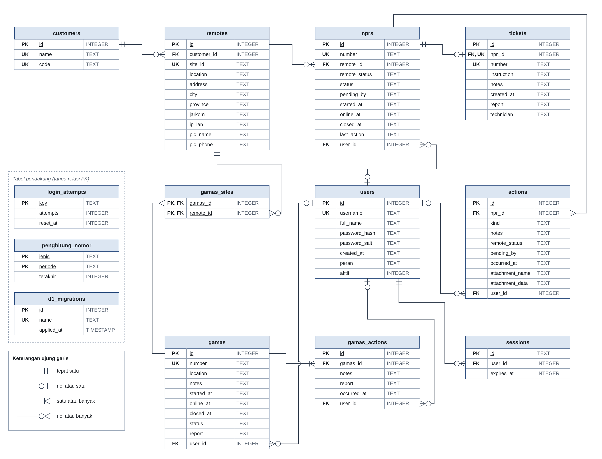

*Gambar 1. ERD aplikasi NPR. Sumber draw.io: [`01-erd.drawio`](gambar/diagram/01-erd.drawio), juga tersedia [`01-erd.svg`](gambar/diagram/01-erd.svg).*

### Kardinalitas

| Hubungan | Kardinalitas | Dasar di kode |
|---|---|---|
| customers → remotes | 1 : 0..N | `remotes.customer_id NOT NULL REFERENCES customers(id)` |
| remotes → nprs | 1 : 0..N | `nprs.remote_id NOT NULL REFERENCES remotes(id)` |
| nprs → actions | 1 : 1..N | Tindakan `Create NPR` disimpan di batch yang sama dengan NPR baru (`worker/domain.ts`) |
| nprs → tickets | 1 : 0..1 | `tickets.npr_id NOT NULL UNIQUE`; Eskalasi kedua ditolak dengan 409 |
| gamas ↔ remotes | N : N lewat `gamas_sites` | PK gabungan `(gamas_id, remote_id)`; satu Gamas berisi 1 sampai 200 remote |
| gamas → gamas_actions | 1 : 1..N | Perkembangan pertama disimpan saat Gamas dibuat |
| users → sessions | 1 : 0..N | `sessions.user_id ... ON DELETE CASCADE` |
| users → nprs, actions, gamas, gamas_actions | 0..1 : 0..N | `user_id` boleh kosong di skema (hasil `ALTER TABLE`), tetapi aplikasi selalu mengisinya |

Tiga tabel tidak berhubungan lewat FK:

- `penghitung_nomor` menyimpan nomor terakhir per jenis dokumen (NPR, TT, GAMAS) dan per bulan WIB.
  Nomor di `nprs.number`, `tickets.number`, dan `gamas.number` dibuat dari tabel ini, tetapi tidak
  ada FK karena nomor disalin sebagai teks.
- `login_attempts` mencatat jumlah percobaan login per alamat IP selama 15 menit.
- `d1_migrations` mencatat migrasi yang sudah dijalankan. Tabel ini dibuat oleh Wrangler (Cloudflare)
  atau oleh `server/migrasi.ts` (Docker), bukan oleh `schema.sql`.

### Keterangan kolom

Supaya gambar tetap cukup kecil untuk halaman laporan, keterangan kolom tidak ditulis di dalam ERD,
tetapi di tabel berikut.

| Kolom | Keterangan |
|---|---|
| `nprs.number`, `tickets.number`, `gamas.number` | Nomor dokumen `NPR/YYYY/MM/0001`, `TT/YYYY/MM/0001`, `GAMAS/YYYY/MM/0001`, urut per bulan WIB dari `penghitung_nomor` |
| `nprs.started_at`, `gamas.started_at` | Waktu mulai gangguan (teks ISO, UTC) |
| `nprs.online_at`, `nprs.closed_at`, `gamas.online_at`, `gamas.closed_at` | Boleh kosong; diisi saat Close |
| `nprs.last_action` | Catatan tindakan terakhir, untuk ditampilkan di daftar NPR |
| `nprs.remote_status`, `actions.remote_status` | Jenis gangguan atau keadaan remote |
| `actions.attachment_data` | Isi lampiran dalam base64 (maksimal 500 KB); hanya dikirim saat lampiran dibuka |
| `tickets.npr_id` | FK sekaligus UK: satu NPR paling banyak punya satu TT |
| `tickets.notes`, `tickets.report`, `tickets.technician` | Catatan NOC saat eskalasi, report teknisi, dan nama teknisi |
| `gamas.location` | Lokasi penanganan, mis. HUB atau data center |
| `user_id` di `nprs`, `actions`, `gamas`, `gamas_actions` | Akun yang mencatat data itu |
| `users.password_hash`, `users.password_salt` | Hash PBKDF2 (SHA-256, 100.000 putaran) dan salt acak. Password asli tidak disimpan |
| `sessions.id`, `sessions.expires_at` | UUID acak yang juga menjadi isi cookie `npr_session`; berlaku 8 jam (milidetik sejak 1970) |
| `login_attempts.key`, `login_attempts.reset_at` | Alamat IP dan batas waktu 15 menit untuk menghitung percobaan login |
| `penghitung_nomor.periode` | Bulan WIB dalam bentuk `YYYY-MM` |

### Nilai yang diizinkan

| Kolom | Nilai | Dijaga oleh |
|---|---|---|
| `remotes.jarkom` | `VSAT`, `M2M` | `CHECK` di skema dan `worker/domain.ts` |
| `nprs.remote_status`, `actions.remote_status` | `ATM Offline`, `Remote Down`, `Remote Idle`, `Relokasi`, `Reposisi`, `Maintenance`, `Preventive Maintenance`, `Other` | `worker/domain.ts` |
| `nprs.status` | `OPEN` (baru), `PENDING`, `ESKALASI`, `CLOSED` | `worker/domain.ts` |
| `nprs.pending_by`, `actions.pending_by` | kosong (belum dikategorikan), `TM`, `Customer` | `worker/domain.ts` |
| `actions.kind` | `Create NPR`, `Problem`, `Eskalasi Service`, `Report Teknisi`, `Close` | `worker/domain.ts` |
| `tickets.instruction` | `Maintenance`, `Preventive Maintenance` | `CHECK` di skema dan `worker/domain.ts` |
| `gamas.status` | `OPEN` (baru), `IN PROGRESS`, `CLOSED` | `worker/domain.ts` |
| `users.peran` | `admin`, `helpdesk` | `CHECK` di migrasi 0002 |
| `users.aktif` | `1` (aktif), `0` (nonaktif) | `CHECK` di migrasi 0002 |

Catatan:

- `nprs.pending_by` di `schema.sql` punya nilai bawaan `'Customer'`, tetapi kode selalu mengisi
  kosong saat NPR dibuat. Jadi nilai bawaan itu tidak pernah terpakai.
- Akun arsip (dibuat migrasi 0002 untuk nama pencatat lama) memakai `password_hash = '!'` dan
  `aktif = 0`. Akun ini tidak bisa login dan tidak tampil di menu Pengguna.

---

## 2. Use case

Diagram use case menunjukkan siapa memakai aplikasi dan untuk apa. Kotak "Sistem NPR" adalah batas
aplikasi. Oval di dalamnya adalah use case (kegiatan yang bisa dilakukan).

- **Helpdesk** memakai semua menu kecuali Pengguna.
- **Admin** adalah Helpdesk dengan hak tambahan. Panah bersegitiga kosong dari Admin ke Helpdesk
  adalah generalisasi: Admin bisa melakukan semua use case Helpdesk, ditambah use case berwarna
  oranye di kotak "Khusus Admin (kelola Pengguna)".
- **Teknisi** tidak punya akun dan tidak membuka aplikasi. Teknisi hanya menerima PDF TT (dan PDF
  TT Gamas) yang dikirim helpdesk di luar aplikasi, lalu melaporkan hasil kerjanya kepada helpdesk.
  Garis putus-putus menandai penyerahan di luar aplikasi.

Pembatasan Admin dijaga di dua tempat: menu Pengguna disembunyikan untuk helpdesk (`src/App.tsx`),
dan server menolak `/api/users` dengan 403 untuk peran selain admin (`worker/pengguna.ts`).

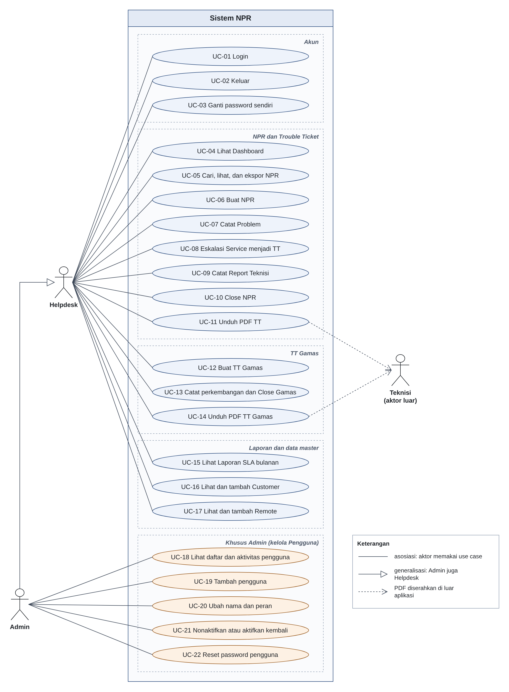

*Gambar 2. Use case aplikasi NPR. Sumber draw.io: [`02-use-case.drawio`](gambar/diagram/02-use-case.drawio), juga tersedia [`02-use-case.svg`](gambar/diagram/02-use-case.svg).*

### Skenario per use case

Prasyarat umum untuk UC-02 sampai UC-22: pengguna sudah login dan akunnya aktif. Setiap
penyimpanan juga ditolak bila sesi habis (pengguna diminta login lagi).

| UC | Aktor | Prasyarat | Alur utama | Alur alternatif |
|---|---|---|---|---|
| UC-01 Login | Helpdesk, Admin | Punya akun aktif yang dibuat admin | 1) Buka alamat aplikasi. 2) Sistem memeriksa sesi; bila belum login, form Login tampil. 3) Isi username dan password, klik Masuk. 4) Sistem mencocokkan password, membuat sesi 8 jam, dan mengirim cookie. 5) Halaman yang dibuka tampil. | Sesi masih berlaku: langsung masuk tanpa form. Username atau password salah: "Username atau password salah." Akun nonaktif: "Akun ini sudah dinonaktifkan. Hubungi admin." Lebih dari 20 percobaan dari satu IP dalam 15 menit: diminta mencoba lagi 15 menit kemudian. |
| UC-02 Keluar | Helpdesk, Admin | Sudah login | 1) Buka menu akun, pilih Keluar. 2) Sistem menghapus sesi dan cookie. 3) Form Login tampil. | Permintaan gagal (mis. jaringan putus): pesan galat, tetap di halaman. |
| UC-03 Ganti password sendiri | Helpdesk, Admin | Sudah login | 1) Menu akun, pilih Ganti Password. 2) Isi password lama, password baru (minimal 12 karakter), dan ulangi password baru. 3) Simpan. 4) Sistem menyimpan password baru dan mengakhiri sesi lain milik akun itu. | Password lama salah, atau password baru kurang dari 12 karakter: ditolak dengan pesan. |
| UC-04 Lihat Dashboard | Helpdesk, Admin | Sudah login | 1) Buka Dashboard. 2) Sistem menampilkan jumlah NPR aktif, kritis (lebih dari 2 hari), aging (1 sampai 2 hari), menunggu report, pending per kategori, grafik NPR 7 hari, Gamas aktif, dan 10 NPR aktif terlama. 3) Klik kartu untuk membuka daftar NPR yang sudah tersaring. | Data gagal dimuat: pesan galat. |
| UC-05 Cari, lihat, dan ekspor NPR | Helpdesk, Admin | Sudah login | 1) Buka menu NPR. 2) Cari, saring (customer, status, tanggal, kondisi), urutkan, dan pindah halaman. Semua dikerjakan server. 3) Buka detail NPR: data site, TT, riwayat tindakan, lampiran. 4) Ekspor CSV (maksimal 5.000 baris). | Tidak ada hasil: tampil keadaan kosong. NPR tidak ditemukan: pesan "NPR tidak ditemukan." |
| UC-06 Buat NPR | Helpdesk, Admin | Remote sudah terdaftar (UC-17) | 1) Klik NPR Baru. 2) Pilih jarkom, customer, dan remote. 3) Pilih jenis gangguan, isi mulai gangguan (WIB) dan catatan. 4) Simpan. 5) Sistem memberi nomor `NPR/YYYY/MM/0001`, status OPEN, pending kosong, dan mencatat tindakan Create NPR. 6) Detail NPR terbuka. | Mulai gangguan di masa depan: ditolak. Remote tidak ditemukan: ditolak. |
| UC-07 Catat Problem | Helpdesk, Admin | NPR belum CLOSED | 1) Di detail NPR pilih Problem. 2) Pilih Pending Customer atau Pending TM (wajib), status remote, waktu tindakan, catatan, dan lampiran bila perlu. 3) Simpan. 4) Status menjadi PENDING, atau tetap ESKALASI bila NPR sudah punya TT. | Kategori pending kosong, waktu mendahului riwayat terakhir atau di masa depan, lampiran bukan PNG/JPEG/WebP/PDF atau lebih dari 500 KB: ditolak. |
| UC-08 Eskalasi Service menjadi TT | Helpdesk, Admin | NPR belum CLOSED dan belum punya TT | 1) Pilih Eskalasi Service. 2) Pilih instruksi Maintenance atau Preventive Maintenance, isi catatan NOC dan waktu. 3) Klik Kirim TT. 4) Sistem membuat TT bernomor `TT/YYYY/MM/0001`; status NPR menjadi ESKALASI dan pending menjadi TM. 5) Tombol Unduh PDF TT muncul. | NPR sudah punya TT: pilihan Eskalasi tidak tampil, dan server menolak dengan 409. |
| UC-09 Catat Report Teknisi | Helpdesk, Admin (isi dari Teknisi) | NPR punya TT dan belum CLOSED | 1) Teknisi melaporkan hasil kerja kepada helpdesk di luar aplikasi. 2) Pilih Report Teknisi, isi nama teknisi dan isi report. 3) Simpan. 4) Report tersimpan di TT; status tetap ESKALASI. | NPR belum punya TT: pilihan tidak tampil, dan server menolak. |
| UC-10 Close NPR | Helpdesk, Admin | NPR belum CLOSED. Bila punya TT, report teknisi sudah dicatat | 1) Pilih Close. 2) Isi waktu tindakan, waktu kembali online, dan catatan. 3) Simpan. 4) Status menjadi CLOSED; waktu online dan waktu tutup tersimpan; riwayat tidak bisa diubah lagi. | NPR tanpa TT: boleh langsung Close. Ada TT tanpa report: tombol Simpan terkunci dan server menolak. Waktu online di luar rentang mulai gangguan sampai waktu Close: ditolak. |
| UC-11 Unduh PDF TT | Helpdesk, Admin. Teknisi menerima | TT sudah ada | 1) Dari menu Trouble Ticket atau detail NPR, klik Unduh PDF. 2) Browser menyusun PDF: kop, data site, gangguan, kotak hasil pekerjaan, tanda tangan. 3) Berkas tersimpan. 4) Helpdesk mengirimkannya ke teknisi di luar aplikasi. | PDF gagal dibuat: "PDF gagal dibuat. Silakan coba unduh kembali." |
| UC-12 Buat TT Gamas | Helpdesk, Admin | Remote terdampak sudah terdaftar | 1) Klik TT Gamas Baru. 2) Isi lokasi penanganan, mulai gangguan, catatan, dan pilih remote terdampak. 3) Simpan. 4) Sistem memberi nomor `GAMAS/YYYY/MM/0001` dengan status OPEN, lalu detail Gamas terbuka. | Tidak ada remote dipilih atau lebih dari 200, remote tidak ditemukan, atau waktu di masa depan: ditolak. |
| UC-13 Catat perkembangan dan Close Gamas | Helpdesk, Admin | Gamas belum CLOSED | 1) Di detail Gamas isi waktu perkembangan, catatan, dan report teknisi bila ada. 2) Simpan; status menjadi IN PROGRESS. 3) Untuk menutup: centang "Tutup TT Gamas" dan isi waktu kembali online. 4) Status menjadi CLOSED. | Waktu mendahului perkembangan terakhir; tutup tanpa report (baru atau sebelumnya); tutup tanpa waktu online; waktu online di luar rentang: ditolak. |
| UC-14 Unduh PDF TT Gamas | Helpdesk, Admin. Teknisi menerima | Gamas sudah ada | 1) Klik Unduh PDF di daftar atau detail Gamas. 2) Browser mengambil detail dan daftar site terdampak, lalu menyusun PDF. 3) Helpdesk mengirimkannya ke teknisi di luar aplikasi. | PDF gagal dibuat: pesan galat. |
| UC-15 Lihat Laporan SLA bulanan | Helpdesk, Admin | Sudah login | 1) Buka Laporan SLA (bulan ini). 2) Pilih bulan dengan tombol sebelumnya dan berikutnya. 3) Server menghitung SLA per site. 4) Ringkasan, target 99,5%, dan site di bawah target tampil. 5) Cari, saring, dan ekspor CSV bila perlu. | Bulan depan tidak bisa dipilih. Bulan di alamat tidak valid: kembali ke bulan ini. |
| UC-16 Lihat dan tambah Customer | Helpdesk, Admin | Sudah login | 1) Buka Customer: daftar dengan jumlah remote, NPR aktif, NPR bulan ini. 2) Tambah: isi nama dan kode. 3) Simpan. | Nama atau kode sudah ada: "Data sudah ada…" (409). Kode selain huruf, angka, dan tanda minus: ditolak. |
| UC-17 Lihat dan tambah Remote | Helpdesk, Admin | Customer sudah ada | 1) Buka Remote (bisa disaring per customer). 2) Tambah: customer, Site ID, lokasi, alamat, kota, provinsi, jarkom, IP LAN, PIC, telepon. 3) Simpan. | Site ID sudah ada (409), IP LAN tidak valid, atau jarkom selain VSAT/M2M: ditolak. |
| UC-18 Lihat daftar dan aktivitas pengguna | Admin | Login sebagai admin | 1) Buka menu Pengguna. 2) Sistem menampilkan akun beserta NPR dicatat, TT dibuat, tindakan bulan ini, dan tindakan terakhir. | Helpdesk membuka `/pengguna`: "Menu ini hanya untuk admin." Server juga menolak dengan 403. |
| UC-19 Tambah pengguna | Admin | Login sebagai admin | 1) Klik tambah pengguna. 2) Isi username (3 sampai 32 karakter: huruf kecil, angka, titik, minus, garis bawah), nama lengkap, peran, dan password awal (minimal 12 karakter). 3) Simpan. | Username sudah dipakai (409) atau formatnya salah: ditolak. |
| UC-20 Ubah nama dan peran | Admin | Login sebagai admin | 1) Pilih akun, menu Ubah Nama dan Peran. 2) Ubah nama lengkap atau peran. 3) Simpan. | Mengubah admin aktif terakhir menjadi helpdesk: "Harus ada minimal satu admin aktif." |
| UC-21 Nonaktifkan atau aktifkan kembali | Admin | Login sebagai admin | 1) Pilih akun, menu Nonaktifkan (atau Aktifkan Kembali). 2) Sistem menyimpan status. 3) Bila dinonaktifkan, semua sesi akun itu langsung diakhiri. | Menonaktifkan akun sendiri ditolak. Menonaktifkan admin aktif terakhir ditolak. |
| UC-22 Reset password pengguna | Admin | Login sebagai admin | 1) Pilih akun, menu Reset Password. 2) Isi password baru (minimal 12 karakter). 3) Simpan. 4) Semua sesi akun itu diakhiri, kecuali sesi admin yang sedang dipakai. | Password kurang dari 12 karakter: ditolak. |

Akun admin pertama dan reset password lewat terminal server (`node dist/server/setup.js` dan
`--reset-password`) bukan use case aplikasi web, jadi tidak digambar.

---

## 3. Activity diagram

Activity diagram menggambarkan urutan kegiatan dari awal sampai akhir. Bulatan hitam adalah titik
mulai, bulatan hitam bercincin adalah titik selesai, kotak bersudut bulat adalah kegiatan, dan belah
ketupat adalah keputusan (pilihan ya atau tidak). Kotak merah muda berisi penolakan dengan pesan.

Setiap diagram dibagi menjadi swimlane, yaitu kolom berjudul yang menunjukkan siapa mengerjakan
kegiatan di dalamnya. Swimlane Teknisi bergaris putus-putus karena kegiatannya terjadi di luar
aplikasi.

### 3.1 Login

Tiga swimlane: pengguna, browser (tampilan React), dan server (API beserta database). Semua
penolakan dari server dikirim kembali ke browser sebagai pesan, lalu pengguna bisa mencoba lagi.

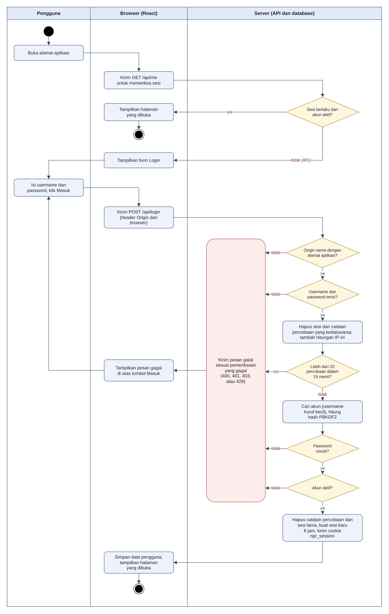

*Gambar 3.1. Activity diagram Login. Sumber draw.io: [`03a-activity-login.drawio`](gambar/diagram/03a-activity-login.drawio), juga tersedia [`03a-activity-login.svg`](gambar/diagram/03a-activity-login.svg).*

### 3.2 Siklus NPR

Satu NPR dimulai dari pencatatan gangguan dan berakhir saat Close. Di antaranya helpdesk bisa
mencatat Problem berkali-kali. Bila perlu teknisi, helpdesk melakukan Eskalasi Service, yang
membuat TT. Setelah teknisi melapor, helpdesk mencatat Report Teknisi. NPR tanpa TT boleh langsung
Close; NPR dengan TT baru bisa Close setelah report teknisi tercatat.

Aturan yang berlaku untuk semua tindakan (tidak digambar satu per satu supaya diagram tetap
terbaca): waktu tindakan tidak boleh di masa depan dan tidak boleh mendahului tindakan terakhir,
NPR yang sudah CLOSED tidak bisa diubah, dan lampiran maksimal 500 KB.

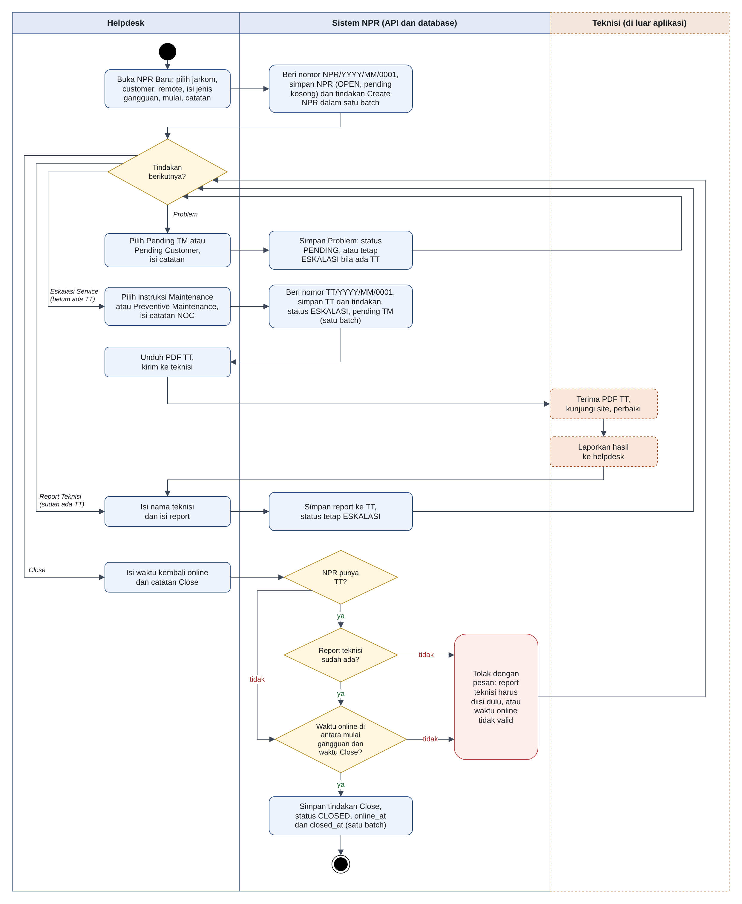

*Gambar 3.2. Activity diagram siklus NPR. Sumber draw.io: [`03b-activity-siklus-npr.drawio`](gambar/diagram/03b-activity-siklus-npr.drawio), juga tersedia [`03b-activity-siklus-npr.svg`](gambar/diagram/03b-activity-siklus-npr.svg).*

### 3.3 TT Gamas

TT Gamas dipakai untuk gangguan yang mengenai banyak site sekaligus. Satu TT Gamas mencakup 1 sampai
200 remote. Setiap perkembangan dicatat dengan waktu, catatan, dan report teknisi bila sudah ada.
Untuk menutup, report teknisi wajib ada (diisi saat itu atau di perkembangan sebelumnya) dan waktu
kembali online wajib diisi.

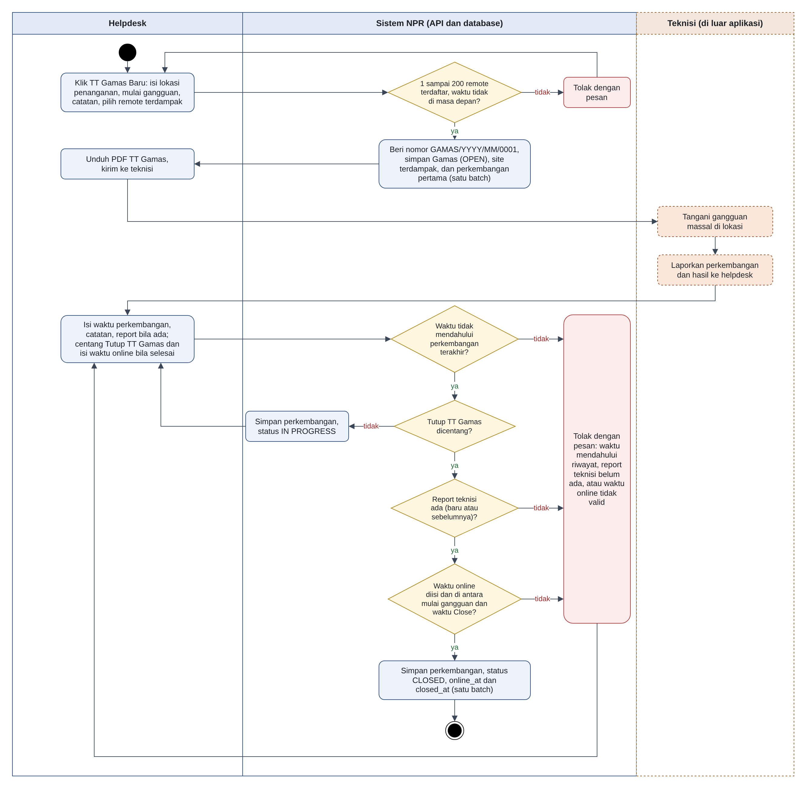

*Gambar 3.3. Activity diagram TT Gamas. Sumber draw.io: [`03c-activity-gamas.drawio`](gambar/diagram/03c-activity-gamas.drawio), juga tersedia [`03c-activity-gamas.svg`](gambar/diagram/03c-activity-gamas.svg).*

### 3.4 Laporan SLA bulanan

SLA dihitung server setiap kali halaman Laporan SLA dibuka, tidak disimpan di database. Yang
dihitung sebagai downtime tanggung jawab TM:

- NPR yang punya TT berinstruksi **Maintenance**, dari mulai gangguan sampai kembali online, kecuali
  segmen saat NPR berstatus Pending Customer. NPR tanpa TT dan TT Preventive Maintenance tidak
  dihitung.
- TT Gamas, untuk semua site terdampak, dari mulai gangguan sampai kembali online. Gamas tidak punya
  jeda Pending Customer.

Rumusnya: SLA = (total menit periode − menit downtime) ÷ total menit periode × 100. Rincian aturan
ada di `monitoring-vsat/ATURAN-SLA.md`.

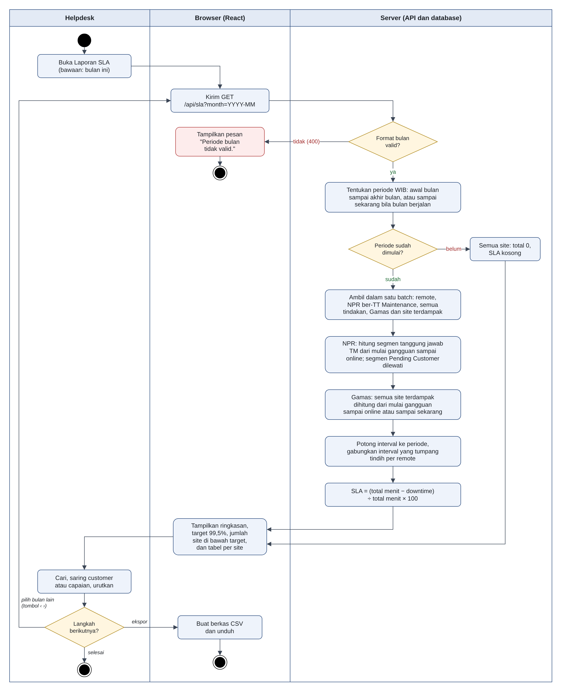

*Gambar 3.4. Activity diagram Laporan SLA bulanan. Sumber draw.io: [`03d-activity-sla.drawio`](gambar/diagram/03d-activity-sla.drawio), juga tersedia [`03d-activity-sla.svg`](gambar/diagram/03d-activity-sla.svg).*

---

## 4. Sequence diagram

Sequence diagram menunjukkan pesan yang dikirim antarbagian sistem, berurutan dari atas ke bawah.
Bagian yang digambar:

- **Helpdesk**: orang yang memakai aplikasi.
- **Browser (React)**: tampilan aplikasi yang berjalan di browser.
- **API (worker)**: kode di `monitoring-vsat/worker/`. Di server Docker, permintaan masuk lewat
  `server/main.ts` lalu diteruskan ke kode worker yang sama.
- **Database**: SQLite di server Docker (lewat `server/d1.ts`) atau D1 di Cloudflare.

Tiga pemeriksaan yang muncul di diagram:

1. **Cek Origin (CSRF).** Setiap permintaan selain GET, HEAD, dan OPTIONS harus membawa header
   `Origin` yang sama dengan alamat aplikasi. Browser menambahkannya sendiri. Bila berbeda, server
   menolak dengan 403. Ini mencegah situs lain mengirim perubahan data atas nama pengguna.
2. **Cek sesi.** Setiap `/api/*` selain login, `/api/me`, dan logout mencari sesi dari cookie
   `npr_session` yang belum kedaluwarsa dan akunnya masih aktif. Bila tidak ada: 401.
3. **Batch transaksi.** Perintah yang harus berhasil bersama dikirim dalam satu batch. Di Docker,
   `server/d1.ts` membungkusnya dengan `BEGIN IMMEDIATE` … `COMMIT`, dan `ROLLBACK` bila satu
   perintah gagal. Bingkai hijau berlabel `critical` di diagram menandai batch.

Cara membaca diagram:

- Pesan diberi nomor urut. Panah penuh adalah permintaan, panah putus-putus adalah balasan.
- Bingkai `break` berarti alur berhenti di situ dan server langsung mengirim pesan galat. Syaratnya
  tertulis di dalam kurung siku.
- Bingkai `alt` berisi pilihan, dipisah garis putus-putus (mis. PDF berhasil atau gagal dibuat).
- Kotak kuning adalah catatan.

### 4.1 Login

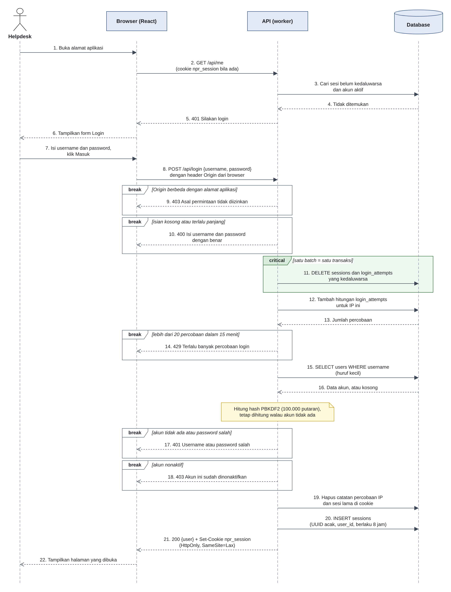

*Gambar 4.1. Sequence diagram Login. Sumber draw.io: [`04a-sequence-login.drawio`](gambar/diagram/04a-sequence-login.drawio), juga tersedia [`04a-sequence-login.svg`](gambar/diagram/04a-sequence-login.svg).*

### 4.2 Buat NPR

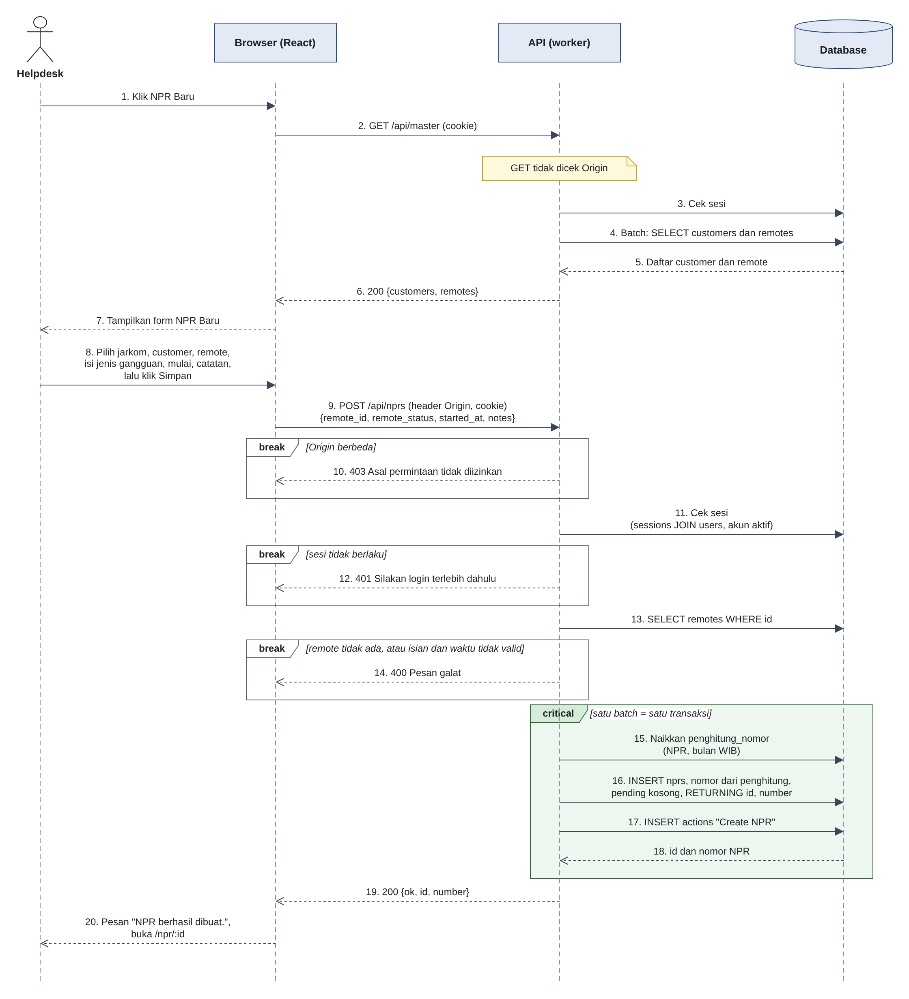

*Gambar 4.2. Sequence diagram Buat NPR. Sumber draw.io: [`04b-sequence-buat-npr.drawio`](gambar/diagram/04b-sequence-buat-npr.drawio), juga tersedia [`04b-sequence-buat-npr.svg`](gambar/diagram/04b-sequence-buat-npr.svg).*

### 4.3 Eskalasi menjadi TT

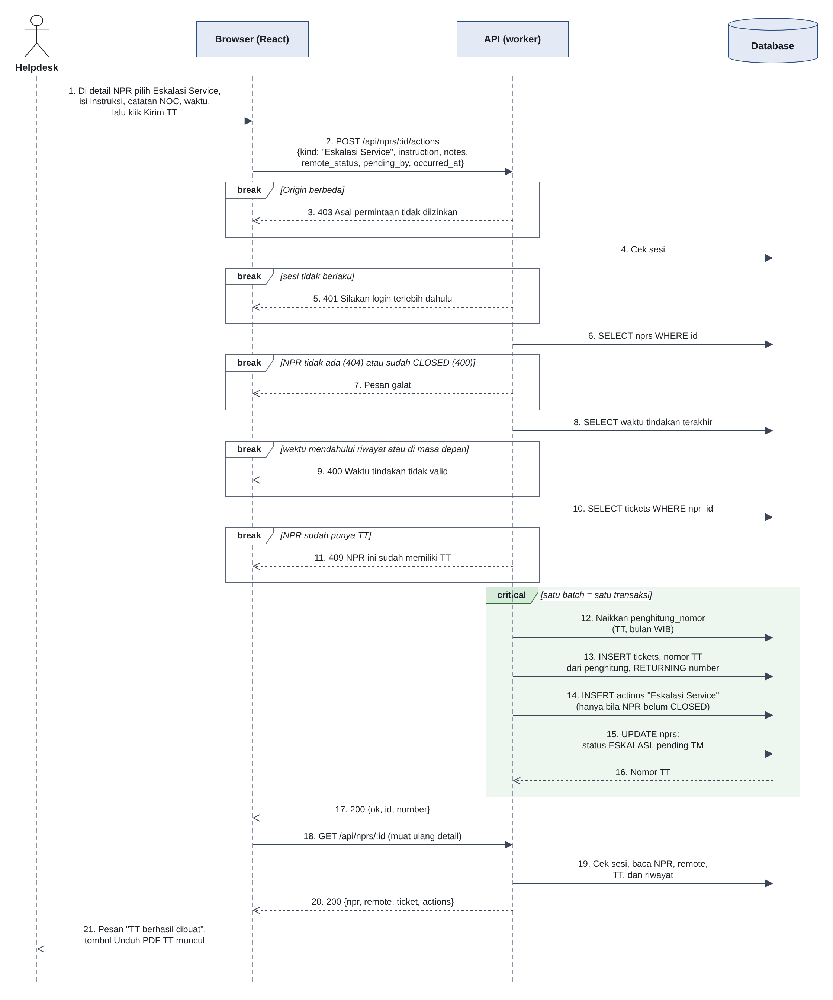

*Gambar 4.3. Sequence diagram Eskalasi menjadi TT. Sumber draw.io: [`04c-sequence-eskalasi-tt.drawio`](gambar/diagram/04c-sequence-eskalasi-tt.drawio), juga tersedia [`04c-sequence-eskalasi-tt.svg`](gambar/diagram/04c-sequence-eskalasi-tt.svg).*

### 4.4 Close NPR

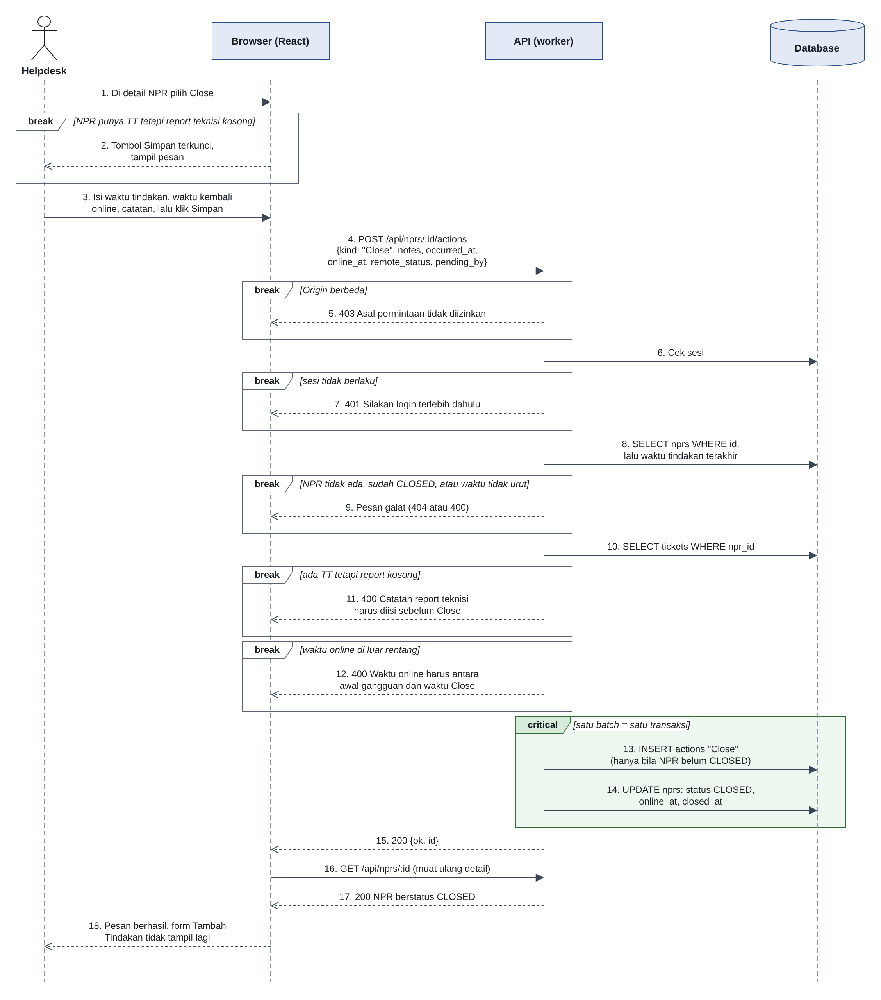

*Gambar 4.4. Sequence diagram Close NPR. Sumber draw.io: [`04d-sequence-close-npr.drawio`](gambar/diagram/04d-sequence-close-npr.drawio), juga tersedia [`04d-sequence-close-npr.svg`](gambar/diagram/04d-sequence-close-npr.svg).*

### 4.5 Unduh PDF TT

PDF dibuat seluruhnya di browser memakai pustaka jsPDF. Server hanya mengirim data TT, tidak
membuat berkas PDF. Teknisi digambar di kiri karena hanya berhubungan dengan helpdesk.

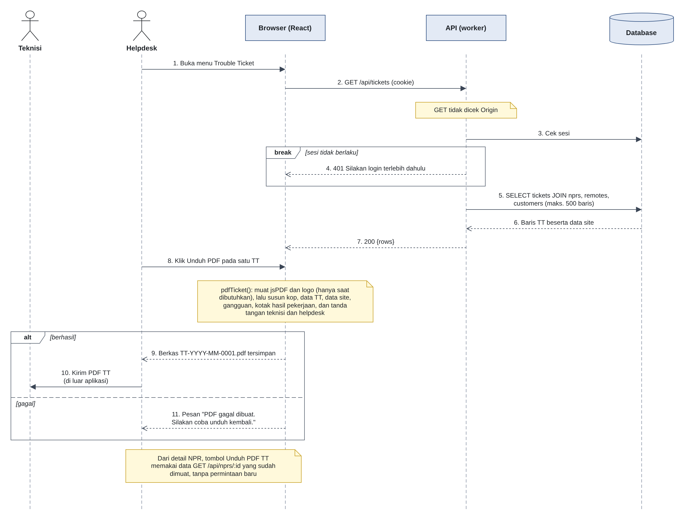

*Gambar 4.5. Sequence diagram Unduh PDF TT. Sumber draw.io: [`04e-sequence-pdf-tt.drawio`](gambar/diagram/04e-sequence-pdf-tt.drawio), juga tersedia [`04e-sequence-pdf-tt.svg`](gambar/diagram/04e-sequence-pdf-tt.svg).*

---

## 5. Class diagram

### 5.1 Class diagram versi domain

Kode NPR tidak memakai kelas: data disimpan sebagai baris tabel, dan aturannya ditulis sebagai
fungsi di `worker/domain.ts` dan `worker/pengguna.ts`. Diagram ini adalah model domain: setiap kelas
mewakili satu jenis data, atributnya mengikuti kolom tabel, dan operasinya mewakili aturan yang
dijalankan server untuk data itu.

- Garis biasa adalah asosiasi (hubungan). Angka di ujung garis adalah multiplisitas, mis. `0..1`
  berarti nol atau satu.
- Belah ketupat hitam adalah komposisi: bagian tidak ada tanpa induknya. Tindakan selalu milik satu
  NPR, perkembangan selalu milik satu Gamas.
- Tanda `+` berarti publik (bisa dipakai bagian lain), `-` berarti privat (hanya dipakai di dalam).

Pemetaan operasi ke kode:

| Operasi | Kode |
|---|---|
| `Customer.tambah`, `Remote.tambah` | `POST /api/customers`, `POST /api/remotes` |
| `Npr.buat` | `POST /api/nprs` |
| `Npr.catatProblem`, `eskalasi`, `catatReportTeknisi`, `close` | `POST /api/nprs/:id/actions` dengan `kind` sesuai |
| `Action.unduhLampiran` | `GET /api/lampiran/:id` |
| `Ticket.unduhPdf`, `Gamas.unduhPdf` | `pdfTicket()`, `pdfGamas()` di `src/pdf.ts` (di browser) |
| `Gamas.buat`, `catatPerkembangan`, `close` | `POST /api/gamas`, `POST /api/gamas/:id/actions` (`close: true` untuk menutup) |
| `User.login`, `keluar`, `gantiPassword` | `POST /api/login`, `/api/logout`, `/api/password` |
| `User.tambah`, `ubah`, `resetPassword`, `daftar` | `/api/users`, `/api/users/:id`, `/api/users/:id/password` (khusus admin) |

Perhitungan SLA bukan milik satu kelas. Fungsi `sla()` di `worker/domain.ts` membaca Remote, Npr,
Action, Ticket, dan Gamas sekaligus (lihat activity 3.4).

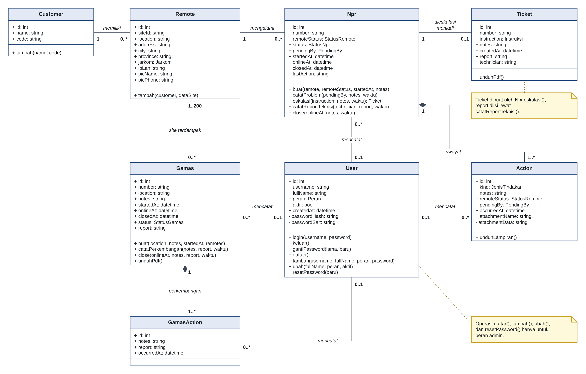

*Gambar 5.1. Class diagram versi domain. Sumber draw.io: [`05a-class-domain.drawio`](gambar/diagram/05a-class-domain.drawio), juga tersedia [`05a-class-domain.svg`](gambar/diagram/05a-class-domain.svg).*

### 5.2 Nilai tetap (enumerasi)

Jenis data yang hanya boleh berisi nilai tertentu. Nama nilai ditulis persis seperti di database,
kecuali `kosong` yang berarti teks kosong. Baris atas berisi nilai untuk NPR dan TT, baris bawah
untuk Remote, TT Gamas, dan akun.

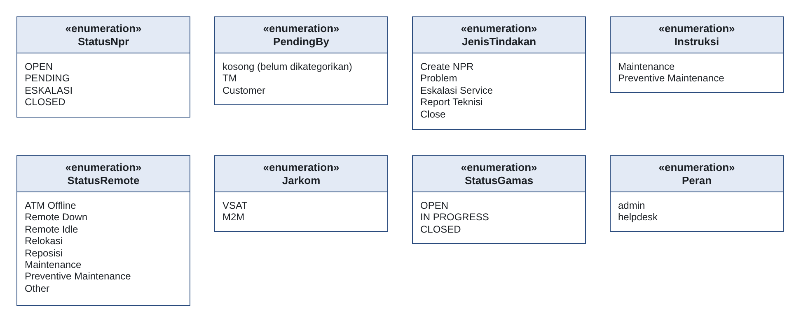

*Gambar 5.2. Nilai tetap (enumerasi). Sumber draw.io: [`05b-enumerasi.drawio`](gambar/diagram/05b-enumerasi.drawio), juga tersedia [`05b-enumerasi.svg`](gambar/diagram/05b-enumerasi.svg).*

Perubahan status NPR menurut `worker/domain.ts`:

| Tindakan | Status sesudahnya | Pending sesudahnya |
|---|---|---|
| Create NPR | OPEN | kosong |
| Problem | PENDING, atau tetap ESKALASI bila NPR punya TT | TM atau Customer (wajib dipilih) |
| Eskalasi Service | ESKALASI | TM |
| Report Teknisi | ESKALASI | sesuai pilihan (form terisi kategori saat ini) |
| Close | CLOSED | sesuai pilihan (form terisi kategori saat ini) |

### 5.3 Diagram modul

Diagram modul menunjukkan susunan berkas program dan siapa memakai siapa. Panah berarti "memakai"
atau "memanggil". Aplikasi bisa berjalan di dua tempat dengan kode API yang sama: server sendiri
lewat Docker (dipakai di server produksi) atau Cloudflare Workers. Kotak bergaris putus-putus di
dalam Server Docker hanya pengelompokan: "Akses database" dipakai oleh `main.ts` dan oleh perintah
terminal.

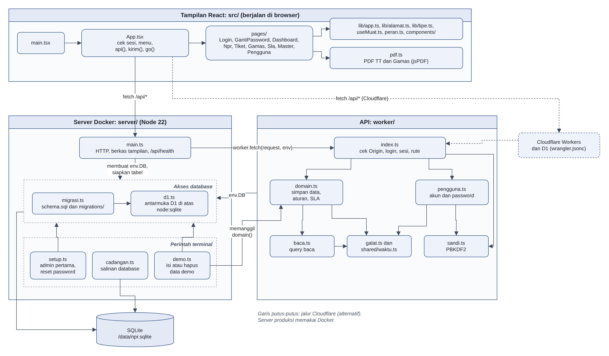

*Gambar 5.3. Diagram modul. Sumber draw.io: [`05c-modul.drawio`](gambar/diagram/05c-modul.drawio), juga tersedia [`05c-modul.svg`](gambar/diagram/05c-modul.svg).*

`demo.ts` adalah perintah terminal untuk mengisi data demo lewat `domain()` yang sama dengan API,
jadi nomor, status, dan SLA data demo dihitung dengan aturan yang sama. Garis putus-putus adalah jalur
Cloudflare. Di Docker, `server/main.ts` mengirim alamat `/api/*` ke
`worker/index.ts` dan alamat lain ke berkas tampilan hasil build (`index.html` untuk alamat halaman).

---

## 6. Perbedaan dokumen dan kode

Diagram di atas mengikuti kode. Perbedaan yang ditemukan saat mencocokkan dokumen dengan kode:

| No. | Dokumen | Isi dokumen | Isi kode | Dipakai di diagram |
|---|---|---|---|---|
| 1 | `review/REDESAIN-NPR.md` (bagian data per halaman) dan `review/HANDOVER-SESI.md` (bagian 4) | TT, Gamas, SLA, Customer, Remote, dan Pengguna dikirim sekaligus, maksimal 500 baris | Batas `LIMIT 500` hanya ada di `GET /api/tickets` dan `GET /api/gamas` (`worker/baca.ts`). `GET /api/master`, `GET /api/users`, dan `GET /api/sla` mengirim semua baris tanpa batas | Kode: "maks. 500 baris" hanya ditulis untuk TT |
| 2 | `review/RENCANA-REVISI.md` (K-02) | Tabel `penghitung_nomor` berisi jenis, tahun, bulan, nomor terakhir | Kolomnya `jenis`, `periode` (gabungan tahun-bulan `YYYY-MM`), dan `terakhir` (`migrations/0001_nomor_urut.sql`) | Kode |
| 3 | `review/RENCANA-REVISI.md` (D-6, K-02) | Nomor urut per bulan untuk NPR dan TT | Gamas juga memakai nomor urut per bulan: `GAMAS/YYYY/MM/0001` (`nomorBaru(db, "GAMAS")`) | Kode |
| 4 | `review/RENCANA-REVISI.md` (tahap 2, Database) | Kolom `created_by` di NPR, tindakan, TT, dan Gamas diganti id pengguna | `user_id` ditambahkan ke `nprs`, `actions`, `gamas`, dan `gamas_actions`. Tabel `tickets` tidak punya `created_by` maupun `user_id`; pembuat TT diketahui dari tindakan `Eskalasi Service` | Kode: `tickets` tanpa FK ke `users` |
| 5 | `review/REDESAIN-NPR.md` (tabel Pengguna) | Angka di menu Pengguna dihitung dari `actions` dan `nprs` | "Tindakan bulan ini" dan "Tindakan terakhir" juga menghitung `gamas_actions` (perkembangan Gamas) | Kode (UC-18) |
| 6 | `monitoring-vsat/PANDUAN-MULAI.md` (daftar berkas) | `schema.sql`: tabel aplikasi | `schema.sql` hanya versi awal. Tabel `penghitung_nomor` ada di migrasi 0001; kolom `peran`, `aktif`, dan `user_id` ada di migrasi 0002; kolom `created_by` di `schema.sql` dihapus oleh migrasi 0002 | Kode: ERD memakai keadaan setelah migrasi |

Perbedaan kecil di dalam kode sendiri (bukan antara dokumen dan kode), dicatat supaya tidak
membingungkan saat membaca diagram:

- `schema.sql` memberi `nprs.pending_by` nilai bawaan `'Customer'`, tetapi `POST /api/nprs` selalu
  mengisi kosong. Diagram memakai perilaku kode (pending kosong saat NPR dibuat).
- Form Close NPR mewajibkan waktu kembali online, tetapi server memakai waktu Close bila `online_at`
  tidak dikirim. Untuk Close Gamas, server ikut mewajibkannya. Diagram mengikuti alur form.
- Form lampiran menerima JPG, PNG, dan PDF, sedangkan server juga menerima WebP.

---

## 7. Cara mengubah dan mengekspor gambar

Sumber setiap gambar adalah berkas `.drawio` di `review/gambar/diagram/`.

**Mengubah di draw.io (paling mudah):**

1. Buka [app.diagrams.net](https://app.diagrams.net) atau draw.io Desktop.
2. Pilih File, Open from, Device, lalu pilih berkas `.drawio`.
3. Ubah diagramnya, lalu simpan kembali ke berkas yang sama.
4. Untuk Word: File, Export as, PNG. Pilih Zoom 200% dan Border Width 20 supaya hasilnya sama dengan
   berkas PNG yang ada.

**Mengekspor semua sekaligus dari terminal** (butuh Node 22 dan Playwright dengan Chromium):

```bash
node review/gambar/diagram/render-drawio.mjs
```

Skrip ini memuat mesin gambar draw.io versi 32.7.7 di Chromium, lalu membuat PNG (skala dua kali,
latar putih) dan SVG (teks biasa tanpa `foreignObject`) dari setiap berkas `.drawio`. Untuk sebagian
saja, tambahkan `SAJA=01-erd,02-use-case` di depan perintah.

Gaya yang dipakai di semua diagram:

- Font Arial ukuran 12 sampai 14. Di Linux diganti Liberation Sans yang ukurannya sama, jadi lebar
  teks tetap pas saat dibuka di Windows.
- Warna navy untuk kotak dan kepala tabel, kuning untuk keputusan dan catatan, merah muda untuk
  penolakan, oranye bergaris putus-putus untuk teknisi (di luar aplikasi).
- Garis siku dengan panah penuh. Garis putus-putus hanya untuk balasan, jalur di luar aplikasi, atau
  jalur Cloudflare.

### Ukuran gambar untuk Word

Ukuran di bawah dalam piksel layar (PNG berisi dua kali lipatnya). Halaman A4 tegak dengan margin
4-3-3-3 cm menyisakan lebar sekitar 14 cm. Diagram yang lebar atau tinggi akan mengecil, jadi
hurufnya ikut kecil.

| Gambar | Ukuran | Saran penempatan |
|---|---|---|
| 01-erd | 1441 × 1099 | Halaman mendatar (landscape), atau satu halaman penuh |
| 02-use-case | 1043 × 1418 | Satu halaman penuh |
| 03a-activity-login | 1122 × 1772 | Satu halaman penuh |
| 03b-activity-siklus-npr | 1242 × 1512 | Satu halaman penuh |
| 03c-activity-gamas | 1332 × 1302 | Satu halaman penuh |
| 03d-activity-sla | 1202 × 1482 | Satu halaman penuh |
| 04a sampai 04d (sequence) | sekitar 1120 × 1230 sampai 1470 | Satu halaman penuh |
| 04e-sequence-pdf-tt | 1288 × 981 | Satu halaman penuh |
| 05a-class-domain | 1442 × 922 | Halaman mendatar, atau selebar teks |
| 05b-enumerasi | 972 × 393 | Selebar teks |
| 05c-modul | 1422 × 832 | Halaman mendatar, atau selebar teks |
