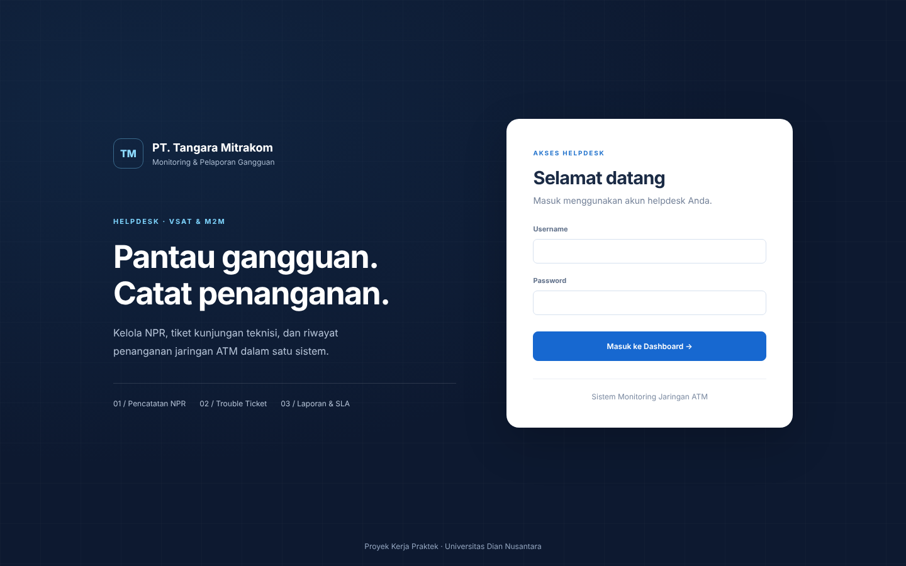
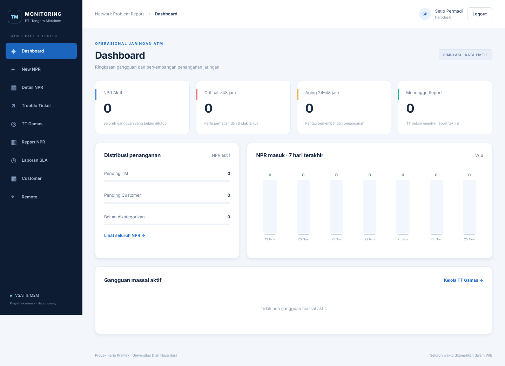
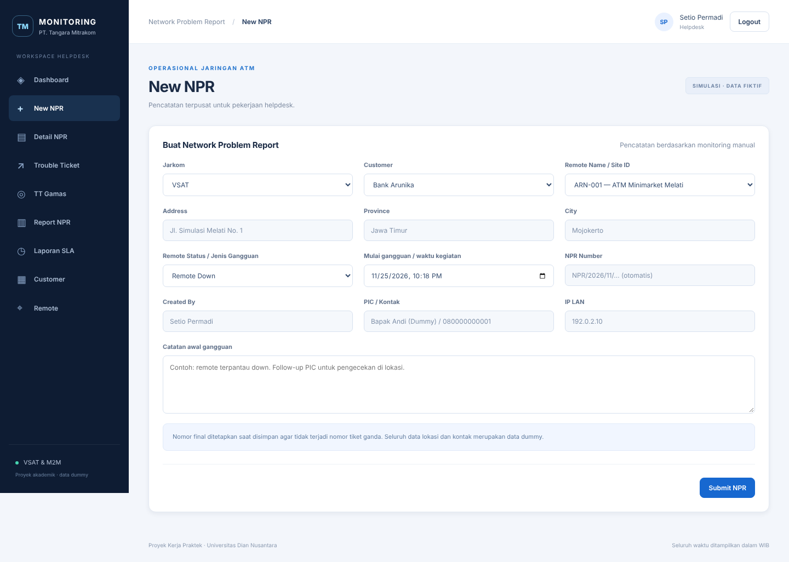
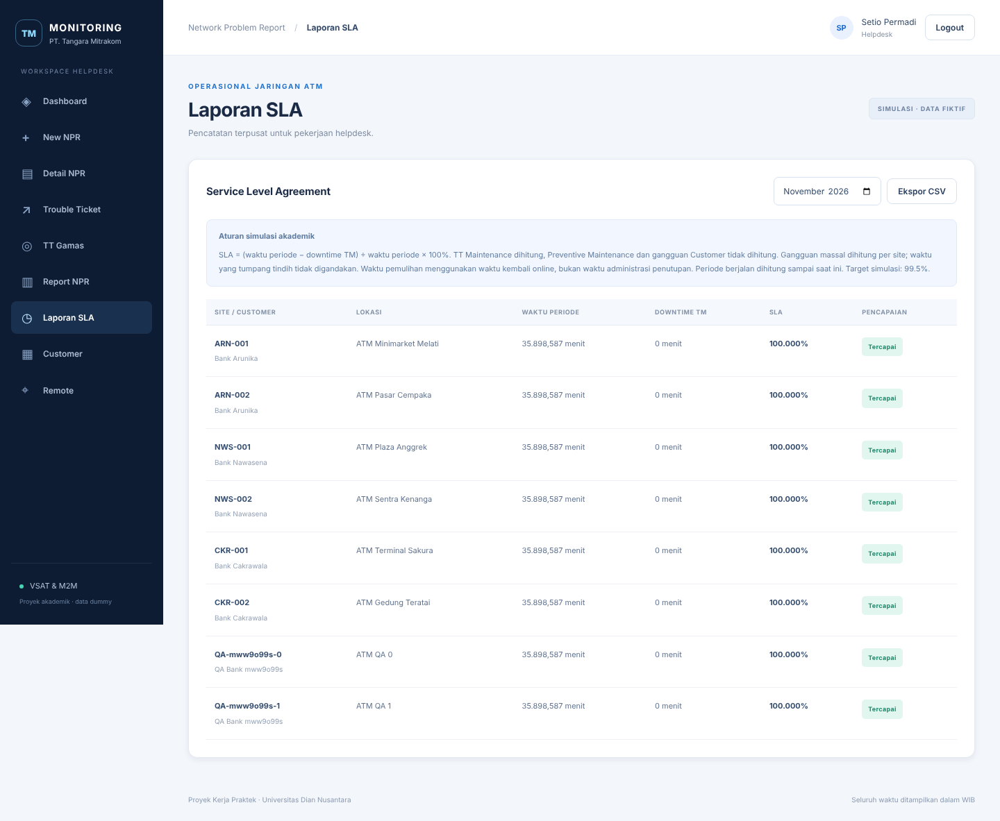
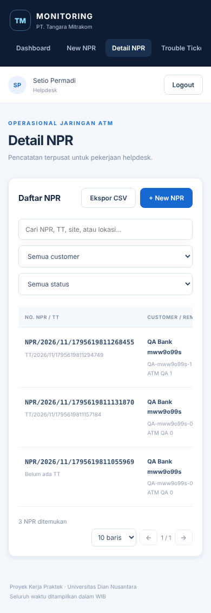
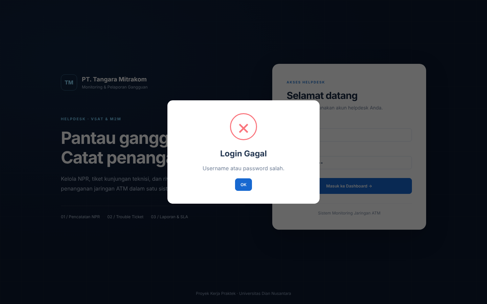
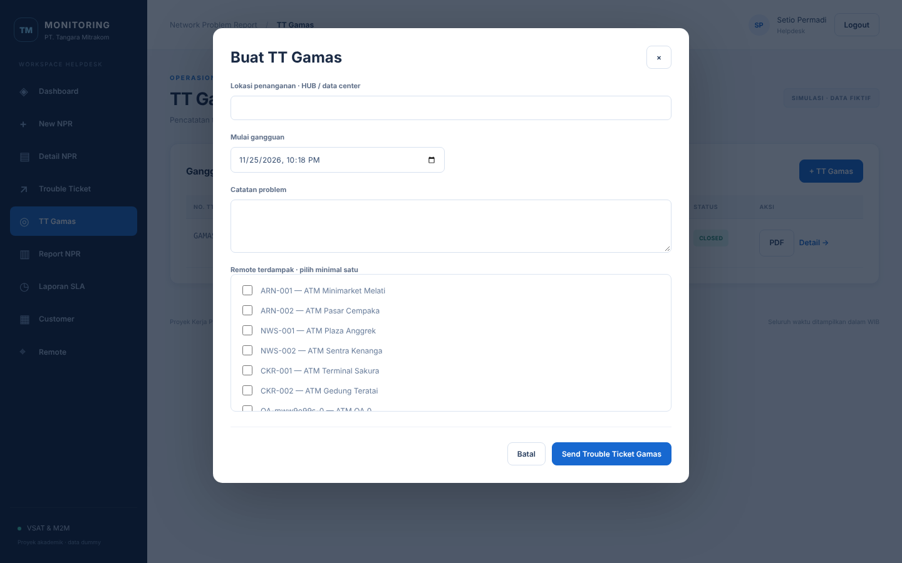

# Review Program NPR (dulu: Monitoring VSAT & M2M)

Tanggal review: 25 November 2026
Sumber: `Monitoring_VSAT_Lengkap.zip` (folder `monitoring-vsat`)
Branch: `Rev-NPR-Tyio`

Isi dokumen:

1. [Ringkasan](#1-ringkasan)
2. [Tabel ringkas untuk dibahas](#2-tabel-ringkas-untuk-dibahas)
3. [Kode](#3-kode-k)
4. [Tata letak UI](#4-tata-letak-ui-u)
5. [UX dan alur kerja](#5-ux-dan-alur-kerja-x)
6. [Humanizer: bagian yang terasa buatan AI](#6-humanizer-bagian-yang-terasa-buatan-ai-h)
7. [Ganti nama ke NPR dan PT. Tangara Mitrakom](#7-ganti-nama-ke-npr-dan-pt-tangara-mitrakom-r)
8. [Yang sudah baik dan sebaiknya dipertahankan](#8-yang-sudah-baik-dan-sebaiknya-dipertahankan)
9. [Pertanyaan yang perlu diputuskan](#9-pertanyaan-yang-perlu-diputuskan-d)
10. [Cara review ini dilakukan](#10-cara-review-ini-dilakukan)

Setiap temuan punya ID (mis. `K-03`) supaya mudah dirujuk saat diskusi. Tingkat:

- **Tinggi**: berdampak langsung ke data, laporan, atau pekerjaan harian helpdesk.
- **Sedang**: mengganggu atau membingungkan, tapi ada jalan keluarnya.
- **Rendah**: perapian.

Nomor baris merujuk ke isi ZIP apa adanya.

---

## 1. Ringkasan

Program berjalan baik di lokal. `npm run build` dan `npm run lint` lulus, dan 20 uji API bawaan
(`npm run test:api`) lulus semua. Dasar keamanannya sudah benar (lihat [bagian 8](#8-yang-sudah-baik-dan-sebaiknya-dipertahankan)).

Masalah utamanya ada di tiga hal:

1. **Data dan laporan.** Status ESKALASI hilang begitu ada tindakan baru (`K-03`), nomor NPR
   berupa 16 digit acak (`K-02`), dan Gamas bisa ditutup dengan jam online yang salah (`K-04`).
2. **Kenyamanan kerja helpdesk.** Huruf terlalu kecil dan pucat (`U-01`, `U-02`), dua menu
   menampilkan daftar yang sama (`X-01`), dan Dashboard tidak menunjukkan NPR mana yang perlu
   ditangani (`X-02`).
3. **Kesan "dibuat AI".** Teks login bergaya iklan, label berhias titik tengah dan panah,
   disclaimer "dummy" diulang di mana-mana, dan gaya kode yang tidak seragam (bagian 6).

Ganti nama ke **NETWORK PROBLEM REPORT (NPR)** dan **PT. Tangara Mitrakom** tersebar di 12 berkas, ditambah `App.css` untuk warna.
Sebagian aman diganti langsung, sebagian (nama worker, nama database) mengubah URL atau data
online, jadi perlu diputuskan dulu (bagian 7 dan 9).

---

## 2. Tabel ringkas untuk dibahas

Kolom **Perlu?** dikosongkan untuk diisi saat diskusi.

| ID | Tingkat | Temuan | Perlu? |
| --- | --- | --- | --- |
| K-01 | Tinggi | Setiap buka/simpan, seluruh database termasuk lampiran ikut diunduh | |
| K-02 | Tinggi | Nomor NPR/TT 16 digit acak, bulan pakai UTC, bisa bentrok | |
| K-03 | Tinggi | Status ESKALASI berubah jadi PENDING setelah ada tindakan baru | |
| K-04 | Sedang | Close Gamas tanpa jam online memakai jam klik; waktu perkembangan Gamas tidak bisa diatur | |
| K-05 | Sedang | Bulan default laporan SLA pakai UTC, bukan WIB | |
| K-06 | Sedang | `App.tsx` 2.222 baris dalam satu komponen, tanpa URL per halaman | |
| K-07 | Sedang | `worker/domain.ts` ditulis padat satu baris, sulit dibaca dan dijelaskan | |
| K-08 | Sedang | Aturan isian beda antara form dan server | |
| K-09 | Rendah | Pesan error teknis muncul kalau server tidak membalas JSON | |
| K-10 | Rendah | Hitung SLA memuat seluruh riwayat sepanjang masa | |
| K-11 | Rendah | Sesi dan catatan login kedaluwarsa tidak pernah dibersihkan | |
| K-12 | Rendah | Grafik 7 hari dihitung ulang berlapis dan memakai zona waktu laptop | |
| K-13 | Rendah | Hanya satu akun tetap (`setio`), tanpa pengelolaan pengguna | |
| K-14 | Rendah | Sisa berkas template (logo Vite/React, gambar hero) tidak dipakai | |
| U-01 | Tinggi | Ukuran huruf 9–12 px di hampir semua tempat | |
| U-02 | Tinggi | Teks abu-abu di bawah standar kontras | |
| U-03 | Sedang | 116 kode warna ditulis langsung, tanpa variabel warna | |
| U-04 | Sedang | Ikon menu berupa karakter Unicode acak | |
| U-05 | Sedang | Tampilan HP: menu terpotong, tabel harus digeser | |
| U-06 | Sedang | Blok judul halaman besar tapi isinya sama di semua halaman | |
| U-07 | Sedang | Form New NPR mencampur isian dan 7 kolom baca-saja | |
| U-08 | Rendah | Dua gaya dialog; modal form tidak bisa ditutup dengan Esc | |
| U-09 | Rendah | Bingkai fokus pada input hampir tidak terlihat | |
| U-10 | Sedang | SLA tertulis "100.000%" (terbaca seratus ribu persen) dan menit berkoma | |
| U-11 | Rendah | Kartu "Menunggu Report" berwarna hijau | |
| X-01 | Tinggi | Menu "Detail NPR" dan "Report NPR" menampilkan daftar yang sama | |
| X-02 | Tinggi | Dashboard hanya angka; tidak ada daftar NPR yang perlu ditangani | |
| X-03 | Sedang | Form tindakan menampilkan semua isian untuk semua jenis tindakan | |
| X-04 | Sedang | Setelah Submit NPR, pengguna dibawa ke daftar, bukan ke NPR baru | |
| X-05 | Sedang | Customer dan Remote tidak bisa diubah | |
| X-06 | Sedang | Memilih site terdampak Gamas tanpa pencarian | |
| X-07 | Sedang | PDF terunduh otomatis dan isinya teks polos tanpa kop | |
| X-08 | Rendah | Urutan riwayat NPR dan Gamas berlawanan | |
| X-09 | Rendah | Daftar TT, Gamas, dan Remote tanpa halaman/paginasi | |
| X-10 | Sedang | Bahasa label campur Inggris dan Indonesia | |
| H-01 | Sedang | Halaman login bergaya iklan | |
| H-02 | Rendah | Label huruf kapital berspasi di mana-mana | |
| H-03 | Rendah | Titik tengah "·" (20×) dan panah "→" (7×) di label dan tombol | |
| H-04 | Rendah | Teks pengisi yang mengulang judul | |
| H-05 | Sedang | Disclaimer "dummy/fiktif/simulasi" diulang 10× | |
| H-06 | Rendah | Catatan yang menjelaskan cara kerja sistem ke pengguna | |
| H-07 | Sedang | Gaya kode dan komentar tidak seragam | |
| H-08 | Sedang | `HASIL-PEMERIKSAAN.md` adalah laporan alat AI, bukan hasil uji sendiri | |
| H-09 | Rendah | Tampilan dashboard generik, belum punya identitas TM | |
| R-01…R-07 | — | Ganti nama, logo, dan warna (bagian 7) | |

---

## 3. Kode (K)

### K-01 (Tinggi): Seluruh database ikut diunduh setiap kali

- **Lokasi:** `worker/domain.ts:16-20`, `src/App.tsx:292-297`, `src/App.tsx:413-414`
- **Masalah:** `GET /api/data` mengirim semua isi tabel (customer, remote, NPR, tindakan, TT, Gamas),
  **termasuk isi lampiran** dalam bentuk base64 (sampai ±500 KB per lampiran). Ini dipanggil saat
  login dan setelah *setiap* simpan.
- **Dampak:** dengan 100 lampiran berukuran 500 KB, satu klik Simpan mengunduh ±68 MB (base64 menambah ukuran ±⅓). Aplikasi akan makin
  lambat seiring waktu, terutama lewat jaringan kantor atau HP.
- **Saran:** pisahkan endpoint per halaman (daftar NPR dengan paginasi, detail NPR per id), dan
  ambil isi lampiran hanya saat tautannya diklik. Untuk jangka panjang, simpan berkas di
  Cloudflare R2, bukan di kolom teks D1.

### K-02 (Tinggi): Nomor NPR/TT sulit dibaca dan bisa bentrok

- **Lokasi:** `worker/domain.ts:8-9`
- **Masalah:**
  - Nomor dibuat dari `Date.now()*1000 + acak`, hasilnya seperti
    `NPR/2026/11/1795619811268455` (lihat [gambar 5](gambar/05-detail-npr.png)). Sulit dibacakan
    lewat telepon ke PIC atau teknisi.
  - Bagian acak hanya 0–999. Dua simpan di milidetik yang sama punya peluang 1:1000 bentrok, dan
    pengguna mendapat pesan "Data sudah ada".
  - Tahun/bulan pada nomor memakai UTC. NPR yang dibuat 1 Desember pukul 00.00–06.59 WIB akan
    bernomor November.
  - Tahun/bulan diambil dari waktu *pembuatan*, bukan waktu gangguan. NPR gangguan 10 Oktober yang
    diinput 25 November bernomor `/2026/11/`.
- **Saran:** nomor urut per bulan WIB, mis. `NPR/2026/11/0001`, dari tabel penghitung di database.
  Putuskan bulan mana yang dipakai (waktu input atau waktu gangguan), lihat `D-6`.

### K-03 (Tinggi): Status ESKALASI hilang

- **Lokasi:** `worker/domain.ts:80`
- **Masalah:** setiap tindakan selain Close dan Eskalasi Service mengubah status menjadi `PENDING`.
  Sudah dicoba: NPR → Eskalasi Service (status `ESKALASI`) → Problem → status jadi `PENDING`.
  Hal yang sama terjadi saat Report Teknisi dicatat.
- **Dampak:** filter status "ESKALASI" tidak menemukan NPR yang sedang ditangani teknisi, dan
  laporan jumlah eskalasi jadi salah.
- **Saran:** jika NPR punya TT dan belum Close, status tetap `ESKALASI`. Atau pisahkan "status
  proses" dari "pending oleh siapa", yang memang sudah ada kolomnya sendiri (`pending_by`).

### K-04 (Sedang): Waktu Gamas

- **Lokasi:** `worker/domain.ts:98-102`, `src/App.tsx:1269-1275`
- **Masalah:**
  - Label form berbunyi "Waktu kembali online · wajib jika ditutup", tapi isian ini tidak wajib.
    Jika kosong, server memakai jam saat tombol diklik. Downtime SLA jadi lebih panjang dari
    kenyataan.
  - Waktu perkembangan Gamas selalu "sekarang". Berbeda dengan NPR yang punya isian
    "Waktu tindakan", jadi perkembangan yang terlambat dicatat tidak bisa diberi jam sebenarnya.
- **Saran:** wajibkan jam online saat menutup (di form dan di server), dan tambahkan isian waktu
  perkembangan seperti pada NPR.

### K-05 (Sedang): Bulan default memakai UTC

- **Lokasi:** `src/App.tsx:263-265`, `worker/domain.ts:110`
- **Masalah:** bulan awal Laporan SLA diambil dari `new Date().toISOString()` (UTC). Tanggal 1 pukul
  00.00–06.59 WIB, laporan terbuka di bulan sebelumnya.
- **Saran:** satu fungsi bantu `bulanWIB()` dipakai di semua tempat (SLA, nomor NPR, grafik).

### K-06 (Sedang): Satu berkas tampilan 2.222 baris

- **Lokasi:** `src/App.tsx` (seluruhnya)
- **Masalah:** semua halaman, form, modal, dan ±29 state ada dalam satu fungsi `App`. Halaman
  disimpan di state, bukan di URL. Sudah dicoba:
  - refresh di halaman Remote → kembali ke Dashboard;
  - tombol Back browser keluar dari aplikasi;
  - tidak ada tautan langsung ke satu NPR untuk dibagikan.
- **Saran:** pecah per halaman (`pages/Dashboard.tsx`, `pages/DaftarNpr.tsx`, `pages/DetailNpr.tsx`,
  dst.) dan pakai router sederhana sehingga alamatnya mis. `/npr/123`. Ini juga memudahkan
  menjelaskan kode saat sidang KP.

### K-07 (Sedang): `worker/domain.ts` ditulis padat

- **Lokasi:** `worker/domain.ts` (seluruhnya)
- **Masalah:** hampir semua logika ditulis satu baris panjang tanpa spasi, mis. baris 5, 18, 80,
  dan 113. Sementara itu `worker/index.ts` ditulis renggang dan rapi. Logika paling penting
  (aturan tindakan dan hitung SLA) justru yang paling sulit dibaca.
- **Saran:** rapikan dengan Prettier, pecah per bagian (`customers.ts`, `nprs.ts`, `gamas.ts`,
  `sla.ts`), dan beri nama variabel yang jelas (`b`, `n`, `s`, `pk`, `gm` → `body`, `npr`,
  `remoteStatus`, `nprId`, `gamasMatch`).

### K-08 (Sedang): Aturan isian beda antara form dan server

- **Lokasi dan contoh:**
  - Lampiran WebP diterima server (`worker/domain.ts:57`) tapi ditolak form (`src/App.tsx:532`, `1151`).
  - Kode customer: form melarang tanda minus (`src/App.tsx:2108`), server mengizinkan (`worker/domain.ts:27`).
  - Isian Remote (kota, provinsi, PIC, telepon) tidak punya batas panjang di form, padahal server
    membatasi. Pengguna baru tahu salah setelah menekan Simpan.
  - Jam online Gamas (lihat `K-04`).
- **Saran:** satu daftar aturan yang dipakai bersama (mis. `shared/aturan.ts`) supaya form dan
  server selalu sama.

### K-09 (Rendah): Pesan error teknis

- **Lokasi:** `src/App.tsx:285`, `src/App.tsx:298-357`
- **Masalah:** fungsi `api()` langsung membaca balasan sebagai JSON. Jika Cloudflare membalas
  halaman HTML (mis. gangguan 502), pengguna melihat pesan seperti
  `Unexpected token '<'`. Tiga `useEffect` juga menulis ulang `fetch` sendiri alih-alih memakai
  `api()`, dan `queueMicrotask` (baris 336) dipakai hanya untuk menghindari aturan lint.
- **Saran:** satu fungsi `api()` untuk semua permintaan, dengan pesan ramah saat balasan bukan JSON.

### K-10 (Rendah): Hitung SLA memuat seluruh riwayat

- **Lokasi:** `worker/domain.ts:114-129`
- **Masalah:** setiap kali laporan dibuka, semua tindakan sepanjang masa dimuat lalu disaring per
  NPR di dalam perulangan. Tidak terasa sekarang, tapi lambat setelah data bertahun-tahun.
- **Saran:** saring di SQL hanya NPR yang beririsan dengan bulan laporan.

### K-11 (Rendah): Sesi kedaluwarsa menumpuk

- **Lokasi:** `worker/index.ts:142-146`, `schema.sql:3-5`
- **Masalah:** baris di tabel `sessions` dan `login_attempts` yang sudah kedaluwarsa tidak pernah dihapus.
- **Saran:** hapus yang kedaluwarsa setiap kali ada login.

### K-12 (Rendah): Grafik 7 hari

- **Lokasi:** `src/App.tsx:1381-1428`
- **Masalah:** nilai tertinggi dihitung ulang dengan perulangan berlapis di setiap batang. Tanggal
  digeser dengan zona waktu laptop (`setDate`), sehingga label bisa bergeser jika laptop tidak di WIB.
- **Saran:** hitung jumlah per hari sekali (di server atau satu `useMemo`), dengan tanggal WIB.

### K-13 (Rendah): Satu akun tetap

- **Lokasi:** `scripts/setup.mjs:8`, `scripts/setup.mjs:28`, `schema.sql:8`
- **Masalah:** hanya ada akun `setio` / `Setio Permadi` dengan password demo `SetioDemo123!`. Tidak
  ada menu tambah pengguna. Kolom `created_by` menyimpan teks nama, bukan id pengguna.
- **Saran:** tergantung `D-3`. Jika dipakai lebih dari satu orang, perlu pengelolaan pengguna dan
  `created_by` diganti menjadi id.

### K-14 (Rendah): Sisa template

- **Lokasi:** `src/assets/react.svg`, `src/assets/vite.svg`, `src/assets/cloudflare.svg`,
  `src/assets/hero.png`, `public/icons.svg`, `public/favicon.svg` (logo Vite ungu)
- **Masalah:** tidak ada yang dipakai. `index.html` juga tidak punya `<link rel="icon">`, jadi tab
  browser tidak menampilkan ikon apa pun.
- **Saran:** hapus, lalu pasang favicon dari logo TM (`R-04`).

---

## 4. Tata letak UI (U)

Tangkapan layar ada di folder [`gambar/`](gambar/).

| | |
| --- | --- |
|  |  |
|  |  |

### U-01 (Tinggi): Huruf terlalu kecil

- **Lokasi:** `src/App.css`. 46 dari 61 aturan `font-size` bernilai 9–12 px. Contoh: judul kolom
  tabel 9 px (`App.css:705-706`), label status 9 px (`App.css:554-555`), teks kecil di tabel
  10 px (`App.css:727-729`).
- **Dampak:** helpdesk menatap layar ini sepanjang shift; nomor NPR dan nama site sulit dibaca.
- **Saran:** dasar 14 px, isi tabel 13 px, paling kecil 12 px.

### U-02 (Tinggi): Kontras teks rendah

Banyak teks abu-abu di bawah batas baca WCAG (4,5 : 1 untuk teks kecil):

| Teks | Warna | Kontras |
| --- | --- | --- |
| Keterangan kecil di tabel (site, lokasi) | `#93a0b4` di putih | 2,65 : 1 |
| Judul kolom tabel | `#8392a8` di `#f5f8fc` | 2,97 : 1 |
| Keterangan kartu dashboard | `#8d9bb0` di putih | 2,82 : 1 |
| Kolom baca-saja di form (alamat, PIC, IP) | `#8091a9` di `#f5f8fc` | 3,01 : 1 |
| Pesan kosong ("Tidak ada …") | `#93a0b3` di putih | 2,65 : 1 |

Kolom baca-saja di form New NPR justru berisi data penting (alamat, PIC, IP LAN), tapi tampil
paling pucat.

- **Saran:** gelapkan abu-abu teks sampai minimal 4,5 : 1.

### U-03 (Sedang): Tidak ada variabel warna

- **Lokasi:** `src/App.css`, `src/index.css`
- **Masalah:** ada 116 kode warna berbeda yang ditulis langsung. Menyesuaikan dengan warna logo TM
  berarti mengubah ratusan tempat satu per satu.
- **Saran:** definisikan warna sekali di `:root` (mis. `--navy`, `--aksen`, `--teks`, `--teks-redup`,
  `--garis`) lalu pakai variabelnya. Ini prasyarat untuk `R-05`.

### U-04 (Sedang): Ikon menu karakter Unicode

- **Lokasi:** `src/App.tsx:134`
- **Masalah:** ikon menu adalah karakter `◈ + ▤ ↗ ◎ ▥ ◷ ▦ ⌖`. Bentuknya berbeda di tiap
  OS/font, maknanya tidak jelas (`↗` untuk Trouble Ticket, `⌖` untuk Remote), dan dibacakan oleh
  pembaca layar.
- **Saran:** pakai satu set ikon SVG (mis. Tabler Icons atau Lucide) dengan `aria-hidden`, atau
  tanpa ikon sama sekali.

### U-05 (Sedang): Tampilan HP

- **Lokasi:** `src/App.css:898-965`
- **Masalah:** pada lebar 390 px, sembilan menu menjadi deretan tombol yang harus digeser
  ("Trouble Ticke…" terpotong). Di daftar NPR, kolom Status dan tombol Detail berada di luar
  layar sehingga tabel harus digeser ke kanan.
- **Saran:** tergantung `D-4`. Jika HP perlu didukung: menu jadi tombol ☰, daftar NPR jadi kartu.
  Jika cukup laptop: tetapkan lebar minimum dan jangan habiskan waktu di sini.

### U-06 (Sedang): Blok judul halaman tanpa informasi

- **Lokasi:** `src/App.tsx:883-900`, `src/App.css:367-395`
- **Masalah:** setiap halaman diawali label "OPERASIONAL JARINGAN ATM", judul besar, subjudul
  "Pencatatan terpusat untuk pekerjaan helpdesk." (sama di semua halaman kecuali Dashboard), dan
  tag "SIMULASI · DATA FIKTIF". Totalnya ±150 px tinggi layar. Nama halaman juga sudah ada di
  topbar ("Network Problem Report / Dashboard").
- **Saran:** satu baris judul halaman, dengan tombol aksinya (mis. "+ NPR Baru") di sebelah kanan.

### U-07 (Sedang): Form New NPR

- **Lokasi:** `src/App.tsx:1497-1609`
- **Masalah:** tiga kolom yang mencampur 6 isian dengan 7 kolom baca-saja berukuran sama (Address,
  Province, City, NPR Number, Created By, PIC, IP LAN). Mata sulit membedakan mana yang perlu diisi.
  Kolom "NPR Number" hanya berisi teks "NPR/2026/11/… (otomatis)" dan "Created By" selalu nama
  sendiri.
- **Saran:** isian di atas (Jarkom → Customer → Remote, Jenis gangguan, Waktu mulai, Catatan), lalu
  data site tampil sebagai kartu info ringkas (alamat, PIC, IP). Hapus kolom NPR Number dan
  Created By.

### U-08 (Rendah): Dua gaya dialog

- **Lokasi:** `src/App.tsx:812-826` (dialog login), `src/App.tsx:2041-2218` (modal form),
  `src/App.css:207-218`
- **Masalah:** login gagal memakai `<dialog>` bawaan browser dengan tanda silang merah besar.
  Form Customer/Remote/Gamas memakai `div` buatan sendiri yang tidak bisa ditutup dengan tombol
  Esc (sudah dicoba), dan fokus keyboard tidak dikurung di dalam modal.
- **Saran:** pakai `<dialog>` untuk semua modal. Untuk login gagal cukup pesan merah di bawah
  form, supaya pengguna bisa langsung mengetik ulang.

### U-09 (Rendah): Bingkai fokus tidak terlihat

- **Lokasi:** `src/App.css:639-643`
- **Masalah:** saat input aktif, bingkainya `#1e75d415` (transparansi 8%), hampir tak terlihat.
  Pengguna keyboard tidak tahu sedang di isian mana.
- **Saran:** bingkai fokus yang jelas, mis. 2 px warna aksen.

### U-10 (Sedang): Angka SLA membingungkan

- **Lokasi:** `src/App.tsx:1868-1884` (lihat [gambar 6](gambar/06-laporan-sla.png))
- **Masalah:** SLA ditulis `100.000%` (titik, 3 desimal), tepat di samping `35.898,587 menit`
  (format Indonesia). Dalam format Indonesia, "100.000" terbaca **seratus ribu**. Menit periode
  juga tampil berkoma.
- **Saran:** `99,95%` (2 desimal, format id-ID), menit dibulatkan atau ditulis dalam jam. Ekspor
  CSV juga dibulatkan.

### U-11 (Rendah): Warna kartu "Menunggu Report"

- **Lokasi:** `src/App.tsx:1316-1325`
- **Masalah:** kartu "Menunggu Report" berwarna hijau, padahal hijau biasa berarti beres.
- **Saran:** kuning/oranye untuk status menunggu.

---

## 5. UX dan alur kerja (X)

### X-01 (Tinggi): Dua menu, satu daftar

- **Lokasi:** `src/App.tsx:1624-1642`, `src/App.tsx:93-133`
- **Masalah:** menu "Detail NPR" ternyata berisi **daftar** NPR, dan menu "Report NPR" menampilkan
  tabel yang sama ditambah filter tanggal. Dari 9 menu, dua isinya sama, dan nama "Detail" untuk
  sebuah daftar menyesatkan.
- **Saran:** gabung jadi satu menu **Daftar NPR** (filter tanggal + Ekspor CSV ada di sana). Usulan
  susunan menu:
  1. Dashboard
  2. NPR (daftar + tombol "NPR Baru")
  3. Trouble Ticket
  4. Gamas
  5. Laporan SLA
  6. Data Master (Customer, Remote)

### X-02 (Tinggi): Dashboard tidak mengarahkan kerja

- **Lokasi:** `src/App.tsx:1287-1465`, `schema.sql:8`
- **Masalah:**
  - Kartu "Critical >48 jam" hanya menampilkan angka, tidak bisa diklik, dan tidak ada daftar NPR mana saja yang dimaksud.
    Helpdesk harus membuka menu lain lalu mencari sendiri.
  - "Belum dikategorikan" selalu 0 karena kolom `pending_by` otomatis berisi `Customer` saat NPR
    dibuat. Akibatnya NPR baru langsung terhitung "Pending Customer" sebelum ada yang memutuskan
    (terlihat di riwayat: "Create NPR … Pending Customer", [gambar 5](gambar/05-detail-npr.png)).
- **Saran:** kartu bisa diklik → daftar NPR terfilter. Tambah tabel "NPR aktif terlama" (5–10 baris)
  di Dashboard. NPR baru dibuat tanpa kategori pending sampai helpdesk memilih.

### X-03 (Sedang): Form tindakan menampilkan semua isian

- **Lokasi:** `src/App.tsx:1047-1153`
- **Masalah:** saat memilih Close, form tetap meminta "Category Pending", "Remote Status", dan
  lampiran. Report Teknisi juga meminta Category Pending.
- **Saran:** tampilkan hanya isian yang relevan per jenis tindakan:
  - **Problem:** catatan, pending oleh, waktu, lampiran
  - **Eskalasi:** instruksi, catatan NOC, waktu
  - **Report Teknisi:** nama teknisi, report, waktu, lampiran
  - **Close:** jam online, catatan penutupan

### X-04 (Sedang): Setelah Submit NPR

- **Lokasi:** `src/App.tsx:1488-1492`
- **Masalah:** setelah NPR dibuat, pengguna dibawa ke daftar NPR. Padahal langkah berikutnya hampir
  selalu menambah tindakan di NPR yang baru dibuat. Server sudah mengembalikan id-nya.
- **Saran:** langsung buka detail NPR yang baru.

### X-05 (Sedang): Data master tidak bisa diubah

- **Lokasi:** `src/App.tsx:1912-2032`
- **Masalah:** Customer dan Remote hanya bisa ditambah. Salah ketik alamat atau telepon PIC
  terbawa selamanya, termasuk ke PDF TT untuk teknisi.
- **Saran:** tombol Ubah. Untuk hapus, lebih aman pakai status "nonaktif" supaya riwayat NPR lama
  tetap utuh.

### X-06 (Sedang): Memilih site terdampak Gamas

- **Lokasi:** `src/App.tsx:2186-2197`
- **Masalah:** semua site tampil sebagai satu daftar centang tanpa pencarian. Dengan ratusan ATM,
  daftar ini tidak bisa dipakai.
- **Saran:** kotak cari, filter customer/kota/jarkom, dan tombol "pilih semua hasil filter".

### X-07 (Sedang): PDF

- **Lokasi:** `src/App.tsx:200-232`, `src/App.tsx:565-572`, `src/App.tsx:2087-2093`
- **Masalah:**
  - PDF langsung terunduh setelah TT/Gamas dibuat, tanpa diminta.
  - Isinya baris-baris "Label: isi" polos: tanpa logo, tanpa tabel, tanpa tempat tanda tangan.
    Untuk dokumen yang diserahkan ke teknisi, ini terlihat belum jadi.
  - Kop PDF bertuliskan "SIMULASI AKADEMIK - DATA FIKTIF" (`src/App.tsx:208`).
- **Saran:** unduh hanya lewat tombol. Tata letak PDF: kop dengan logo dan nama perusahaan, tabel
  data site, kotak catatan, dan tempat tanda tangan teknisi/helpdesk (`D-7`).

### X-08 (Rendah): Urutan riwayat berlawanan

- **Lokasi:** `worker/domain.ts:18`, `src/App.tsx:1008-1010`, `src/App.tsx:1223-1225`
- **Masalah:** riwayat NPR tampil lama → baru, riwayat Gamas baru → lama.
- **Saran:** samakan (lama → baru, seperti kronologi).

### X-09 (Rendah): Daftar tanpa paginasi

- **Lokasi:** `src/App.tsx:1643-1791`, `src/App.tsx:1954-2032`
- **Masalah:** hanya daftar NPR yang punya halaman dan filter status. Daftar TT, Gamas, dan Remote
  akan menjadi satu tabel panjang.
- **Saran:** pakai komponen tabel yang sama untuk semua daftar.

### X-10 (Sedang): Bahasa label campur

- **Contoh Inggris:** Address, Province, City, Created By, NPR Number, Remote Name / Site ID,
  Submit NPR, Add Action NPR, Send Trouble Ticket, Instruction, Category Pending, Logout
- **Contoh Indonesia:** Catatan awal gangguan, Tambah Customer, Simpan tindakan, Kembali ke daftar
- **Saran:** istilah kerja yang memang dipakai di NOC/helpdesk tetap (NPR, TT, Gamas, Pending,
  Remote, Site ID, Jarkom). Sisanya bahasa Indonesia: Alamat, Provinsi, Kota, Simpan NPR,
  Tambah Tindakan, Kirim TT, Instruksi, Pending oleh, Keluar. Lihat `D-8`.

---

## 6. Humanizer: bagian yang terasa buatan AI (H)

Tujuan bagian ini adalah membuat aplikasi terasa dibuat oleh orang yang paham pekerjaan helpdesk
PT. Tangara Mitrakom: bahasanya langsung, tampilannya punya identitas, dan kodenya bisa dijelaskan
baris per baris saat sidang. Tujuannya bukan menyembunyikan bahwa AI dipakai; jika kampus punya
aturan soal penggunaan AI, ikuti aturan itu.

### H-01 (Sedang): Halaman login bergaya iklan

- **Lokasi:** `src/App.tsx:751-807`, `src/App.css:65-80` (lihat [gambar 1](gambar/01-login.png))
- **Ciri:**
  - slogan dua kalimat "Pantau gangguan. Catat penanganan.";
  - daftar fitur bernomor "01 / Pencatatan NPR · 02 / Trouble Ticket · 03 / Laporan & SLA";
  - latar biru gelap berpola kisi dengan cahaya radial;
  - tombol "Masuk ke Dashboard →".

  Ini pola halaman pemasaran. Aplikasi internal tidak perlu "menjual" dirinya ke pengguna yang
  sudah pasti memakainya.
- **Saran:** logo TM, nama aplikasi, form login, dan satu baris keterangan (mis. "Khusus helpdesk
  PT. Tangara Mitrakom"). Tombol cukup "Masuk".

### H-02 (Rendah): Label huruf kapital berspasi

- **Lokasi:** `AKSES HELPDESK` (776), `HELPDESK · VSAT & M2M` (759), `WORKSPACE HELPDESK` (840),
  `OPERASIONAL JARINGAN ATM` (885), `NETWORK PROBLEM REPORT` (929), semua di `src/App.tsx`
- **Saran:** hapus sebagian besar. Pakai paling banyak satu, di tempat yang memang butuh penanda.

### H-03 (Rendah): Titik tengah dan panah

- **Lokasi:** `src/App.tsx`, "·" muncul 20×, "→" 7×
- **Contoh:** "Lampiran opsional · JPG, PNG, PDF · maks. 500 KB", "Report teknisi · isi jika sudah
  diterima", "Kode customer · contoh ARN", "Mulai · WIB", "Detail →", "Kelola TT Gamas →"
- **Saran:** tulis biasa: "Lampiran (JPG, PNG, atau PDF, maks. 500 KB)", "Report teknisi (isi jika
  sudah diterima)", "Kode customer, mis. ARN". Panah cukup untuk tombol Kembali.

### H-04 (Rendah): Teks pengisi

- **Contoh:**
  - keterangan kartu dashboard yang mengulang judul: "Seluruh gangguan yang belum ditutup",
    "Perlu perhatian dan tindak lanjut", "Pantau perkembangan penanganan" (`src/App.tsx:1294-1324`);
  - subjudul halaman yang sama di semua halaman (`src/App.tsx:893-897`);
  - "Urutan waktu pencatatan", "Pencatatan berdasarkan monitoring manual", "Sistem Monitoring
    Jaringan ATM" di bawah form login.
- **Saran:** hapus, atau ganti dengan informasi nyata (mis. "2 di antaranya > 48 jam").

### H-05 (Sedang): Disclaimer berulang

- **Lokasi:** tag "SIMULASI · DATA FIKTIF" (899), sidebar "Proyek akademik · data dummy" (856),
  catatan form "Seluruh data lokasi dan kontak merupakan data dummy" (1612-1613), label
  "Nama bank dummy", "IP LAN dummy", "Nama pengelola / PIC dummy", "Telepon dummy" (2111-2158),
  "Aturan simulasi akademik" (1833), kop PDF (208). Totalnya 10 kali di tampilan.
- **Masalah:** kehati-hatian berlebihan yang khas tulisan AI. Label isian juga jadi aneh: tidak ada
  aplikasi nyata yang memberi label "Telepon dummy".
- **Saran:** tergantung `D-1`. Cukup satu penanda di satu tempat (atau tidak sama sekali), dan
  label isian ditulis normal: "Nama bank", "IP LAN", "Nama PIC", "Telepon PIC".

### H-06 (Rendah): Menjelaskan cara kerja sistem ke pengguna

- **Contoh:** "Nomor final ditetapkan saat disimpan agar tidak terjadi nomor tiket ganda"
  (`src/App.tsx:1610-1614`), "Form Trouble Ticket · Nomor TT dibuat otomatis ketika dikirim.
  Catatan berikut diisi berdasarkan hasil pengecekan NOC." (`src/App.tsx:1089-1093`)
- **Saran:** pengguna cukup melihat nomornya setelah tersimpan. Hapus catatan seperti ini.

### H-07 (Sedang): Gaya kode dan komentar tidak seragam

- **Ciri:**
  - `worker/domain.ts` sangat padat (`K-07`), sedangkan `worker/index.ts` renggang, seperti
    dibuat dalam dua sesi berbeda.
  - Komentar campur bahasa: "Batasi permintaan perubahan data…" (Indonesia) di samping
    "Maintenance confirms a network incident…" dan "File may already have been removed." (Inggris).
  - `scripts/test-api.mjs` mencetak hasil uji dalam bahasa Inggris, padahal seluruh aplikasi
    berbahasa Indonesia.
  - `queueMicrotask` hanya untuk menghindari aturan lint (`src/App.tsx:336`).
  - Sisa template Vite/Cloudflare (`K-14`).
- **Saran:** format seragam (Prettier), komentar seragam bahasa Indonesia yang menjelaskan
  *alasan*, bukan mengulang kode, dan pastikan setiap bagian bisa dijelaskan sendiri saat sidang.

### H-08 (Sedang): `HASIL-PEMERIKSAAN.md`

- **Isi yang dimaksud:** "Browser Chromium tidak dapat dijalankan di lingkungan pemeriksaan karena
  pembatasan socket. Uji DOM tidak membuktikan kesempurnaan visual…"
- **Masalah:** ini laporan kerja alat AI, bukan hasil uji yang dilakukan sendiri. `PANDUAN-MULAI.md`
  juga masih ditujukan "untuk Setio" dan menyebut "akun Cloudflare kaka".
- **Saran:** ganti dengan hasil uji sendiri (tanggal, siapa yang menguji, langkah, hasil,
  tangkapan layar). Pisahkan panduan pribadi dari dokumentasi proyek.

### H-09 (Rendah): Tampilan generik

- **Ciri:** kartu angka dengan garis warna di kiri (`src/App.css:437-454`), label status pastel,
  kartu membulat dengan bayangan tipis, dan "TM" sebagai teks dalam kotak alih-alih logo. Ini
  tampilan "dashboard admin" standar dan belum menunjukkan identitas perusahaan.
- **Saran:** setelah warna logo diterapkan (`R-05`), kurangi hiasan: kartu tanpa garis warna, satu
  warna aksen, dan logo asli di sidebar dan login.

---

## 7. Ganti nama ke NPR dan PT. Tangara Mitrakom (R)

Target:

- Nama aplikasi: **NETWORK PROBLEM REPORT**, nama pendek **NPR**
- Perusahaan: **PT. Tangara Mitrakom** (dengan titik)
- Logo: lampiran, disimpan di [`aset/logo-tangara-mitrakom.png`](aset/logo-tangara-mitrakom.png)

### R-01 · Yang tampil ke pengguna (aman diganti langsung)

| Berkas:baris | Tertulis sekarang | Usulan |
| --- | --- | --- |
| `index.html:8` | `Monitoring VSAT — Helpdesk` | `NPR — PT. Tangara Mitrakom` |
| `index.html:7` | `Sistem monitoring dan pelaporan gangguan VSAT dan M2M untuk tugas Kerja Praktek.` | `Network Problem Report — pencatatan gangguan jaringan PT. Tangara Mitrakom.` |
| `index.html:6` | `theme-color #0d1930` | warna navy logo `#032459` |
| `src/App.tsx:753`, `834` | teks `TM` dalam kotak | gambar logo |
| `src/App.tsx:755-756` | `PT. Tangara Mitrakom` / `Monitoring & Pelaporan Gangguan` | `Network Problem Report` / `PT. Tangara Mitrakom` |
| `src/App.tsx:759` | `HELPDESK · VSAT & M2M` | hapus, atau `Helpdesk VSAT & M2M` (`D-5`) |
| `src/App.tsx:806` | `Sistem Monitoring Jaringan ATM` | hapus |
| `src/App.tsx:836-837` | `MONITORING` / `PT. Tangara Mitrakom` | `NPR` / `PT. Tangara Mitrakom` |
| `src/App.tsx:854-856` | `VSAT & M2M` / `Proyek akademik · data dummy` | sesuai `D-1` dan `D-5` |
| `src/App.tsx:862` | `Network Problem Report / {halaman}` | tetap (sudah sesuai) |
| `src/App.tsx:205-208` | kop PDF: nama PT + `SIMULASI AKADEMIK - DATA FIKTIF` | logo + `PT. Tangara Mitrakom` + `Network Problem Report` (`D-1`, `D-7`) |
| `src/App.tsx:810`, `2037` | `Proyek Kerja Praktek · Universitas Dian Nusantara` | sesuai `D-1` |
| `MULAI-WINDOWS.cmd:4` | `Monitoring VSAT - Persiapan dan jalankan web lokal` | `NPR - Persiapan dan jalankan web lokal` |
| `README.md:1`, `PANDUAN-MULAI.md:1` | `Monitoring VSAT & M2M` | `NPR — Network Problem Report` |
| `ATURAN-SLA.md:3` | `PT Tangara Mitrakom` (tanpa titik) | `PT. Tangara Mitrakom` |

### R-02 · Nama teknis (perlu diputuskan dulu, `D-2`)

| Berkas:baris | Sekarang | Akibat jika diganti |
| --- | --- | --- |
| `package.json:2` | `monitoring-vsat` | aman; hanya nama paket |
| `wrangler.jsonc:3` | `monitoring-vsat` | **alamat online berubah** menjadi `npr.<akun>.workers.dev`; alamat lama mati |
| `wrangler.jsonc:17`, `scripts/setup.mjs:23,24,32` | database `monitoring-vsat-db` | **perlu database baru** di Cloudflare dan memindahkan data; atau biarkan, karena nama ini tidak terlihat pengguna |
| `worker/index.ts:23,71,72` | cookie `vsat_session` | aman; pengguna hanya perlu login ulang sekali |
| `PANDUAN-MULAI.md:12,42` | `monitoring-vsat-lengkap`, `monitoring-vsat-db` | ikut keputusan di atas |

Usulan: ganti nama paket dan cookie, biarkan nama database. Nama worker diganti hanya jika belum
ada yang memakai alamat lamanya.

### R-03 · Istilah "TM" tetap dipakai

"Pending TM", "Downtime TM", dan "tanggung jawab TM" (`src/App.tsx:1084`, `1343`, `1854`,
`worker/domain.ts:52`, `78`, `126-128`) merujuk ke Tangara Mitrakom, jadi sudah benar. Cukup
dijelaskan sekali di Laporan SLA: "TM = PT. Tangara Mitrakom".

### R-04 · Logo dan favicon

- Berkas logo yang dilampirkan: PNG 500×500 dengan **latar putih** (tanpa transparansi).
- Sidebar dan halaman login berlatar biru gelap, jadi perlu versi **latar transparan** (PNG atau,
  lebih baik, SVG). Tanpa itu, logo akan tampil sebagai kotak putih.
- Favicon: buat ukuran 32×32 dan 180×180 dari logo, ganti `public/favicon.svg` (sekarang logo
  Vite), lalu tambahkan `<link rel="icon">` di `index.html`.
- Kop PDF: jsPDF bisa menyisipkan PNG; versi latar putih justru cocok untuk PDF.

### R-05 · Warna dari logo

Warna utama logo (diambil dari berkas):

| Peran | Warna | Catatan |
| --- | --- | --- |
| Navy "TM" | `#032459` | cocok untuk sidebar, judul, tombol utama |
| Biru muda cincin | ±`#53E9FA` | **hanya aksen** (garis menu aktif, ikon). Kontrasnya di latar putih sangat rendah, jangan untuk teks |

Sekarang sidebar `#0e1c33` dan tombol `#1768d0`. Penyesuaian ini jauh lebih mudah setelah `U-03`
(variabel warna).

### R-06 · Akun dan nama pribadi

`setio`, `Setio Permadi`, dan `SetioDemo123!` ada di `scripts/setup.mjs:8,11,13,28,37`,
`scripts/test-api.mjs:48,52,53`, `MULAI-WINDOWS.cmd:18`, `README.md:19`, dan `PANDUAN-MULAI.md:24,57,66`.
Lihat `D-3`.

### R-07 · Nama aplikasi sama dengan nama data

Aplikasinya bernama NPR, dan data utamanya juga NPR ("NPR Baru", "Daftar NPR"). Ini wajar, tapi
untuk menghindari "NPR – Detail NPR", sebutkan nama lengkap **Network Problem Report** hanya di
login, judul tab, dan kop PDF. Di dalam aplikasi cukup logo + "NPR".

---

## 8. Yang sudah baik dan sebaiknya dipertahankan

- **Password:** PBKDF2 100.000 putaran dengan salt, perbandingan hash waktu-konstan, dan tetap
  menghitung hash meskipun username tidak ada (`worker/index.ts:26-63`, `119-123`).
- **Sesi:** cookie `HttpOnly`, `SameSite=Lax`, `Secure` di HTTPS, berlaku 8 jam (`worker/index.ts:20-24`).
- **Perlindungan CSRF:** setiap permintaan ubah data harus berasal dari alamat aplikasi sendiri
  (`worker/index.ts:79-84`).
- **Batas percobaan login:** 20 kali per 15 menit per IP (`worker/index.ts:107-111`).
- **Query SQL:** semua memakai parameter; tidak ada celah SQL injection.
- **Ekspor CSV** sudah mencegah rumus Excel berbahaya (`src/App.tsx:183`) dan memakai BOM supaya
  huruf terbaca benar di Excel.
- **Waktu:** disimpan UTC, ditampilkan WIB, input `datetime-local` ditafsirkan sebagai WIB
  secara eksplisit.
- **Aturan bisnis:** riwayat yang sudah Close tidak bisa diubah; tindakan tidak boleh mundur waktu
  atau di masa depan; satu TT per NPR; report teknisi wajib sebelum Close.
- **Hitung SLA:** gangguan yang tumpang tindih (NPR + Gamas) digabung, tidak dihitung dua kali;
  sudah diuji otomatis.
- **Uji API** (`scripts/test-api.mjs`) menolak berjalan selain di localhost.
- **Skrip setup** aman diulang dan tidak menimpa akun yang sudah ada.

---

## 9. Pertanyaan yang perlu diputuskan (D)

| ID | Pertanyaan | Pilihan |
| --- | --- | --- |
| D-1 | Label akademik ("Proyek Kerja Praktek · Universitas Dian Nusantara", "SIMULASI · DATA FIKTIF", kop PDF) tetap tampil? | a) tetap di semua tempat; b) cukup di footer login; c) hapus semua |
| D-2 | Nama teknis ikut diganti? (alamat worker, nama database, cookie) | a) hanya yang tampil; b) paket + cookie; c) semua, termasuk alamat dan database |
| D-3 | Akun pengguna | a) tetap satu akun `setio`; b) satu akun umum mis. `helpdesk`; c) akun per orang + menu pengguna |
| D-4 | Perlu nyaman dipakai di HP? | a) cukup laptop; b) HP juga |
| D-5 | "VSAT & M2M" tetap disebut? | a) ya, sebagai subjudul; b) tidak |
| D-6 | Format nomor NPR | a) `NPR/2026/11/0001` per bulan input; b) per bulan gangguan; c) biarkan |
| D-7 | PDF TT untuk teknisi | a) cukup tambah logo; b) kop + tabel + tanda tangan |
| D-8 | Bahasa label | a) Indonesia, istilah kerja tetap (NPR, TT, Gamas, Pending, Site ID); b) Inggris semua; c) biarkan |

---

## 10. Cara review ini dilakukan

1. Membaca seluruh kode: `src/App.tsx`, `src/App.css`, `src/index.css`, `worker/index.ts`,
   `worker/domain.ts`, `schema.sql`, `seed-data.sql`, `scripts/`, konfigurasi, dan semua dokumen.
2. Menjalankan di lokal:
   - `npm ci`, `npm run build`, `npm run lint`, `npm run setup`: semua berhasil;
   - `npm run test:api`: 20/20 lulus.
3. Membuka aplikasi di Chromium pada lebar **1440 px** (laptop) dan **390 px** (HP), lalu mengambil
   tangkapan layar setiap halaman. Yang dipakai di dokumen ini ada di folder `gambar/`.
4. Pengecekan tambahan:
   - alur status lewat API (Eskalasi → Problem) untuk `K-03`;
   - tombol Esc pada modal (`U-08`);
   - refresh halaman (`K-06`);
   - perhitungan kontras warna (`U-02`);
   - tanda "—" di PDF: tampil normal, tidak bermasalah.

Belum dilakukan: deploy ke Cloudflare dan uji dengan data dalam jumlah besar.
